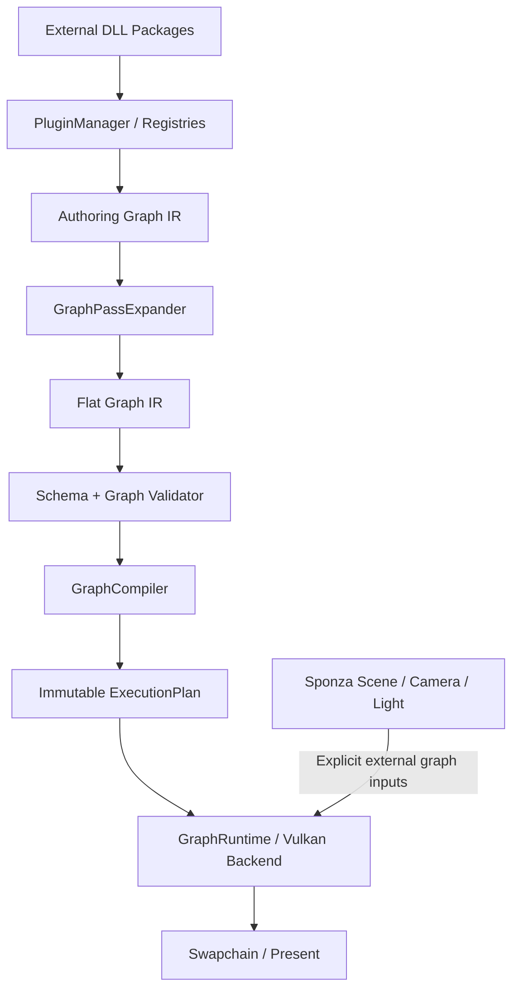
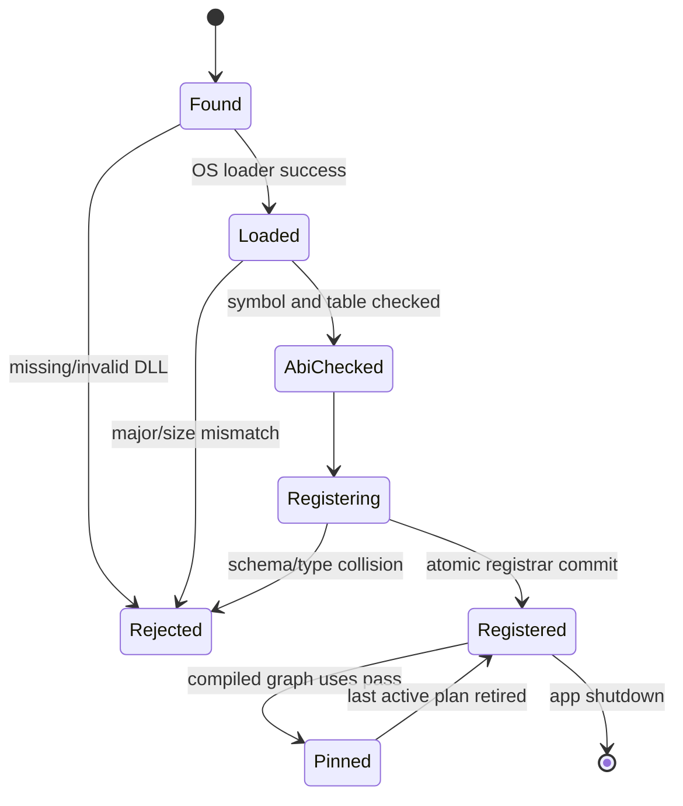
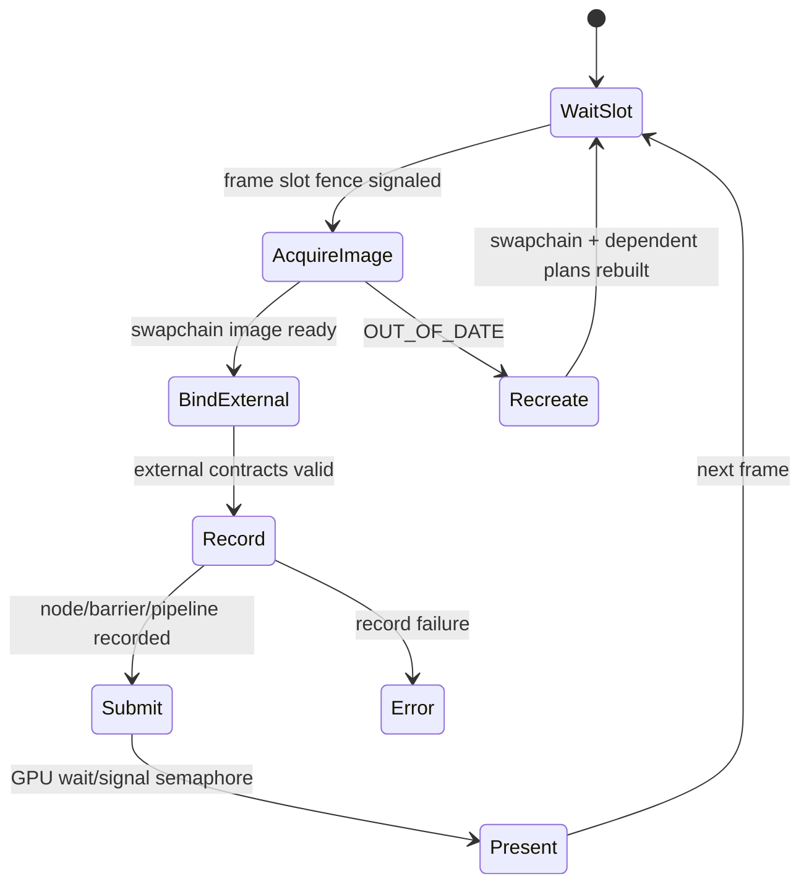
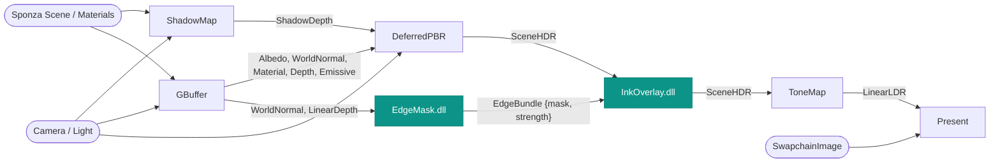
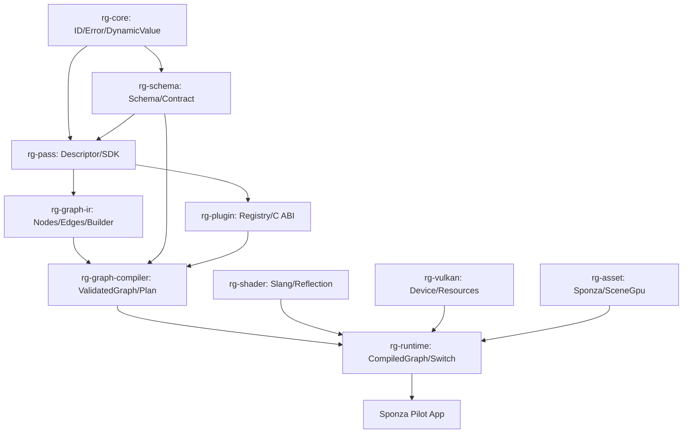

# Sponza 파일럿 렌더러 — Graph IR 중심 전체 클래스·데이터·API 상세설계서

**버전:** v0.2 / **날짜:** 2026-10-14 / **상태:** 구현 전 설계안  
**대상:** Windows x64 · C++20 · Vulkan 1.3 · Slang → SPIR-V · `sponza-png.glb`  
**범위:** Render Graph IR, 확장 가능한 계약 시스템, 독립 DLL Pass/GraphPass, Graph Compiler, GPU Runtime, Sponza Scene, 파일럿 애플리케이션의 **전체 클래스 및 데이터**

> 이 문서의 네임스페이스, 클래스, 필드, API, 오류 코드, 파일 구조는 새로 구현할 **프로젝트 내부 규약**이며, Falcor/Slang/Vulkan에 이미 존재하는 API 명칭이 아니다. 코드 조각은 인터페이스를 구체화하는 **설계용 C++ 의사선언**이다. 그대로 붙여 넣어 컴파일되는 완제품이라는 뜻은 아니다.

https://github.com/Ludicon/sponza-gltf/tree/main

## 0. 무엇을 구현하는 설계인가

### 0.1 목표

이 파일럿이 보여 주어야 하는 것은 **Sponza 렌더러 자체의 화려함이 아니라 외부 연구자가 렌더링 데이터 구조·실행 Pass·Pass 연결 규칙까지 독립 배포할 수 있다는 사실**이다.

동일한 `RendererPilot.exe`에서 다음 시나리오를 통과한다.

1. `sponza-png.glb`를 로드하고 Deferred PBR(+그림자)로 1280×720 장면을 표시한다.
2. 개발자 A는 `EdgeMask.dll`을 SDK만 이용해 독립 빌드하고 `research.EdgeBundle` 데이터 계약을 등록한다.
3. 개발자 B는 `InkOverlay.dll`을 **별도 DLL**로 빌드해 A의 계약을 입력으로 받는다.
4. 개발자 C는 `SponzaStylizedGraph.dll`에서 **GraphPass**를 작성해 기본 Pass와 A/B의 Pass를 선택·생성·연결한다.
5. 앱을 다시 빌드하지 않고 DLL만 설치한 후, `outline.enabled` 토글로 두 실행 그래프를 교체한다.
6. 필수 포트 누락, 의미·포맷 불일치, 순환 의존성을 의도적으로 주입하면 **GPU 실행 전에 실패**하고 기존 그래프를 유지한다.

### 0.2 고정 범위와 제외 범위

| 구분 | 파일럿 정책 |
|---|---|
| 그래픽 API | **Vulkan 1.3** 단일 백엔드, graphics queue 하나에서 graphics/compute 기록 |
| 셰이더 | **Slang**, SPIR-V 산출; Slang Reflection을 바인딩/레이아웃 검증에 사용 |
| 장면 | Ludicon `sponza-png.glb` 한 개, 로컬 파일에서 1회 로드 |
| 기본 렌더링 | ShadowMap → GBuffer → DeferredPBR → ToneMap → Present |
| 외부 Pass | EdgeMask, InkOverlay, SponzaStylizedGraph(상위 GraphPass) |
| 그래프 생성 | **C++ GraphPass**가 생성. JSON 구성 파일은 필수 아님 |
| 데이터 구조 | 외부 DLL의 **Resource Schema / Value Schema** 런타임 등록 |
| 그래프 변경 | CPU 측 후보 Graph 생성·검증·준비 후 **안전한 프레임 경계에서 교체** |
| 리소스 | transient 리소스 별도 할당(초기에는 aliasing OFF), persistent scene asset, swapchain external |
| 제외 | Path Tracing, GI, denoiser, async compute, 일반 그래프 에디터, hot-unload/hot-reload, 복수 GPU 백엔드, 플러그인 샌드박스 |

**검증 해상도:** 1280×720을 기본으로 하되 윈도우 resize를 처리한다. **성능:** GPU 프레임 시간 p95 ≤16.7ms를 목표로 *측정*한다. 성공 보증치가 아니며 플러그인·GPU에 따라 미달할 수 있다.

### 0.3 테스트 에셋 및 전제

- 저장소: <https://github.com/Ludicon/sponza-gltf>
- GLB: <https://github.com/Ludicon/sponza-gltf/blob/main/sponza-png.glb>
- 파일은 **Git LFS** 대상이고 원본 크기는 **117,889,600 bytes**. SHA-256 LFS OID: `258b82df37b703cf383dfc58a64a547814f1b0445cfd9a89bd8867c176921eaf`.
- GLB의 실제 mesh 수, material 수, alphaMode 분포, 필요한 glTF 확장은 **AssetAudit**에서 검사한다. 사전에 임의 값을 가정하지 않는다.
- glTF는 기본적으로 **오른손 좌표계, +Y 위, 길이 단위 m**. `core.LinearDepth`는 이 설계에서 **양의 camera-view z 거리(m)**로 정의하므로 glTF 월드 좌표와 카메라 좌표 사이 변환이 필요하다.
- 에셋 재배포 라이선스는 별도로 확인한다. 파일럿 실행에서는 사용자가 로컬 모델을 공급하도록 한다.

### 0.4 최상위 데이터 흐름



> **중요한 분리:** IR은 *무엇을 연결할지*를 표현한다. ExecutionPlan은 *GPU에서 어떤 순서·자원·장벽으로 실행할지* 표현한다. 둘을 합치면 DLL 확장, 계약 검증, Vulkan 외 백엔드가 서로 얽힌다.

---

## 1. 프로젝트 구성과 네임스페이스

```text
renderer-pilot/
├── CMakeLists.txt
├── sdk/
│   ├── include/rg/api.h                    # DLL 경계: C ABI v1
│   ├── include/rg/core/{Id,Result,Value}.hpp
│   ├── include/rg/schema/{Schema,Type,Registry}.hpp
│   ├── include/rg/pass/{Pass,PassBuilder,Contexts}.hpp
│   ├── include/rg/ir/{GraphIR,GraphBuilder}.hpp
│   └── cmake/RendererSDKConfig.cmake
├── engine/
│   ├── core/                               # 오류·ID·값 공통부
│   ├── schema/                             # 동적 계약 등록·타입 검사
│   ├── plugin/                             # DLL 로더 / ABI / Pass 팩토리
│   ├── graph/ir/                           # GPU 비의존 Graph IR
│   ├── graph/compiler/                     # expand / validate / lower
│   ├── graph/runtime/                      # 실행 계획·프레임 교체
│   ├── backend/vulkan/                     # device, command, resource, frame
│   ├── shader/                             # Slang compiler, reflection, cache
│   ├── asset/                              # GLB, scene, texture upload
│   └── passes/                             # 기본 제공 GPU Pass
├── app/                                    # 창, 입력, 설정, 진단
├── shaders/core/{shadow,gbuffer,pbr,tonemap,present}.slang
├── examples/EdgeMaskPlugin/
├── examples/InkOverlayPlugin/
├── examples/SponzaStylizedGraphPlugin/
├── assets/README.md                       # GLB는 사용자가 공급
└── tests/{core,schema,graph,plugin,asset,gpu,e2e}/
```

**컴포넌트 소유 원칙:**

- `core`, `schema`, `graph/ir`는 **Vulkan/Slang/GLB 헤더에 의존하지 않는다**.
- `plugin`이 DLL 수명을 소유하고 `PassRegistry`가 해당 DLL의 factory 참조를 보유한다.
- `graph/compiler`는 DLL에서 `PassDescriptor`를 읽지만 C++ 객체 포인터를 IR에 저장하지 않는다.
- `graph/runtime`은 특정 `ExecutionPlan`과 필요한 DLL의 **수명 고정 참조**를 소유한다.
- `backend/vulkan`만 `VkImage`, `VkBuffer`, `VkPipeline`, fence 및 descriptor set 등을 가진다.
- `asset`은 장면을 로딩하고 GPU에 올린 뒤 불변 `SceneView`를 공급한다. **장면 로딩 자체는 RenderPass가 아니다.**

---

## 2. 기본 데이터 모델 (`rg::core`)

표의 `필드`는 **논리적으로 필요한 멤버**다. 실제 구현에서 작은 값 타입은 `struct`, 서비스 객체는 `class`로 선택한다. 아래 표를 이후 섹션의 모든 API에서 공통으로 사용한다.

| 타입/클래스 | 필드(자료형) | 역할 및 불변식 | 주요 API |
|---|---|---|---|
| `QualifiedName` | `space:string`, `name:string` | `research.EdgeMask` 등 전역 충돌 방지. 비어 있거나 구분자가 잘못된 값 거부 | `parse(text)`, `toString()` |
| `Version` | `major:u16`, `minor:u16`, `patch:u16` | Pass·Schema·Plugin 버전. ABI 버전과 구별 | `compatibleWith(req)`, 비교 연산 |
| `StrongId<Tag>` | `raw:u64` | `GraphId`, `NodeId`, `EdgeId`, `ResourceId` 등의 혼용 방지 | `valid()`, 비교/해시 |
| `IdAllocator` | `next:u64` | 그래프 스냅샷 내 ID 발급; 삭제 후 ID 재사용 없음 | `allocate<Tag>()` |
| `ContentHash` | `sha256:byte[32]` | 그래프/셰이더/플러그인/에셋의 내용 식별 | `fromBytes()`, `hex()` |
| `SourceRef` | `owner:QualifiedName`, `path:string`, `line:u32?` | 오류 발생 원점: 플러그인·노드·셰이더 등 | `format()` |
| `Error` | `code:ErrorCode`, `message:string`, `stage:Stage`, `source:SourceRef?`, `details:PropertyMap` | 반환 가능한 오류 객체; 실패 원인을 삭제하지 않음 | `withDetail()`, `toString()` |
| `Diagnostic` | `severity:Severity`, `error:Error`, `graphRevision:u64?`, `frameIndex:u64?` | 로그 및 테스트 보고 항목 | `format()` |
| `Result<T>` | `Success(T) \| Failure(Error)` | 예외 대신 오류 전달(ABI 밖 내부 C++에서 사용) | `ok()`, `value()`, `error()` |
| `DynamicValue` | `kind:ValueKind`, `payload:variant<null,bool,i64,u64,f64,string,blob,array,map>` | 매개변수·설정 값 표현; C++ 객체 주소 보관 금지 | `as<T>()`, `validate()` |
| `PropertyMap` | `entries:ordered_map<string,DynamicValue>` | Pass 설정·오류 세부정보·진단. 결정적 직렬화 순서 | `get()`, `set()`, `canonicalHash()` |
| `CapabilitySet` | `api:GraphicsAPI`, `features:bitset`, `formats:set`, `limits:DeviceLimits` | 장치 기능 및 플러그인 요구사항 비교 | `supports(req)`, `fingerprint()` |

`StrongId<Tag>`의 대표 별칭: `GraphId`, `NodeId`, `EdgeId`, `PortId`, `ResourceId`, `PlanId`, `FrameId`, `PluginId`. **이 별칭들은 포인터도 GPU 핸들도 아니다.** 0은 invalid ID, ID 유효 범위는 해당 Graph/Plan 문맥으로 한정한다.

권장 공통 열거형:

```cpp
namespace rg {
  enum class Stage { Asset, Plugin, Schema, Expand, Validate, Compile,
                     Prepare, Record, Submit, Present };
  enum class ErrorCode {
    Ok, InvalidArgument, IdNotFound, DuplicateId,
    AssetLfsPointer, AssetHashMismatch, GlbParseFailed,
    PluginAbiMismatch, PluginDependencyMissing, PluginLoadFailed,
    SchemaNotFound, SchemaConflict, SchemaVersionMismatch,
    SemanticMismatch, ShapeMismatch, FormatMismatch, LayoutMismatch,
    PortNotFound, DirectionMismatch, RequiredInputMissing, RequiredFieldMissing, MultiProducer,
    GraphCycle, GraphRecursion, GraphBudgetExceeded,
    UnsupportedCapability, ShaderCompileFailed, ShaderBindingMismatch,
    ResourceAllocationFailed, SwapchainOutOfDate, DeviceLost
  };
  template<class T> using Result = /* Success<T> | Failure<Error> */ void;
  using GraphId = StrongId<struct GraphTag>;
  using NodeId = StrongId<struct NodeTag>;
  using EdgeId = StrongId<struct EdgeTag>;
  using ResourceId = StrongId<struct ResourceTag>;
}
```

`Result<T>`의 마지막 줄은 **개념 표기**다. 구체 구현 시 `std::expected<T,Error>`(C++23) 대신 C++20에서 사용할 자체 `Result` 또는 `tl::expected` 스타일 구현을 택한다. 템플릿 내용이 `void`라는 뜻이 아니다.

**시스템 불변식 I-01:** 실패한 `GraphBuilder`/`GraphCompiler`/`GraphActivation` 작업은 **현재 활성 Graph와 GPU 실행 상태를 변경하지 않는다**. 후보를 별도 소유하고 성공 시에만 교체한다.

---

## 3. 연구자 확장 데이터 계약 (`rg::schema`)

### 3.1 목적과 핵심 구분

C++ 런타임에서 새로운 컴파일타임 네이티브 `struct`를 즉석에 추가할 수는 없다. 대신 연구자는 런타임에 **스키마(메타데이터)를 생성·등록**할 수 있다. 렌더러는 해당 스키마로 리소스 묶음, 매개변수 레코드, 포트 연결을 해석한다.

1. **Resource Schema**: Texture/Buffer/AS/SceneView 같은 *논리적 리소스* 하나 또는 여러 개의 묶음. **C++ 메모리 구조체가 아님.**
2. **Value Schema**: Uniform/Storage buffer 안에 저장되는 실제 값(필드·정렬·stride). Shader Reflection 결과와 최종 배치 호환 검증.
3. **Semantic**: 값이 *무엇을 의미하는지* (`core.normal.world`, `research.edge.mask`) 표현. 동일 포맷이라고 동일 의미가 아님.
4. **Port Contract**: 위 스키마+해상도+접근 권한+프레임 범위를 특정 Pass의 포트에 적용한 선언.

### 3.2 클래스 및 데이터 필드

| 타입/클래스 | 핵심 필드 | 역할 | 주요 API |
|---|---|---|---|
| `SchemaKey` | `name:QualifiedName`, `version:Version` | 등록된 계약의 고유 이름. `major`가 다른 계약은 기본적으로 호환하지 않음 | `toString()`, `sameMajor()` |
| `SemanticKey` | `name:QualifiedName`, `version:Version` | 물리 포맷과 독립된 의미적 타입 | `toString()` |
| `TypeExpr` | `tag:TypeTag`, `scalar:ScalarDesc?`, `texture:TextureDesc?`, `buffer:BufferDesc?`, `schemaRef:SchemaKey?` | 필드의 물리적 타입을 표현하는 tagged union. 재귀 구조는 SchemaKey 참조 | `isResource()`, `visit()`, `canonicalHash()` |
| `ScalarDesc` | `base:{Bool,I32,U32,F16,F32,F64}`, `rows:u8`, `columns:u8` | 스칼라·벡터·행렬 타입 | `componentCount()` |
| `TextureDesc` | `dimension:{Tex2D,Tex2DArray,Cube}`, `format:PixelFormat`, `samples:u8`, `mips:u16`, `usage:ImageUsage`, `extent:ExtentExpr` | GPU 이미지의 **요구 형식**. 실제 크기는 아직 미확정 | `resolveExtent(env)` |
| `BufferDesc` | `element:SchemaKey?`, `stride:u32?`, `minBytes:u64`, `usage:BufferUsage`, `layout:LayoutKind` | Structured/Uniform/Storage buffer 요구 | `checkLayout(reflection)` |
| `ExtentExpr` | `mode:{Absolute,ScreenScale,SameAs}`, `absolute:Extent2D?`, `scale:(num,den)?`, `reference:PortPath?` | 해상도 규칙을 기호적으로 표현. GPU 크기 결정 전까지 유지 | `resolve(extentEnv)` |
| `MemoryLayoutDesc` | `size:u64`, `alignment:u32`, `stride:u32`, `packing:LayoutKind`, `fields:list<FieldOffset>` | Value Schema의 shader-visible 실제 메모리 레이아웃 | `matches(reflection)` |
| `FieldDesc` | `name:string`, `type:TypeExpr`, `semantic:SemanticKey?`, `required:bool`, `default:DynamicValue?`, `layout:MemoryLayoutDesc?` | 리소스 묶음 또는 값 구조체의 필드 | `validate()` |
| `SchemaDesc` | `key:SchemaKey`, `category:{Resource,ResourceGroup,Value}`, `semantic:SemanticKey?`, `fields:list<FieldDesc>`, `description:string`, `owner:PluginId` | 불변 스키마 정의. 그룹은 필드별 자원을 보유 | `findField()`, `canonicalHash()` |
| `SemanticDesc` | `key:SemanticKey`, `description:string`, `units:string?`, `coordinateSpace:string?`, `colorSpace:string?`, `range:(min,max)?`, `owner:PluginId` | 표준/연구자 시맨틱 사전. 문자열만 같다는 이유로 자동 변환하지 않음 | `validateValueMeta()` |
| `ContractRef` | `schema:SchemaKey`, `mode:{Exact,Compatible}` | 포트가 요구하는 스키마와 호환 정책 | `resolve(registry)` |
| `PortContract` | `type:ContractRef`, `access:AccessMode`, `frameScope:FrameScope`, `extentOverride:ExtentExpr?`, `optional:bool`, `stageHint:PipelineDomain` | 입출력 포트의 완전한 데이터 계약 | `requiredCapabilities()` |
| `FieldBinding` | `consumerField:string`, `producerField:string`, `slot:ResourceId?` | 그룹 계약의 필드별 물리 리소스 대응 | `isResolved()` |
| `CompatibilityReport` | `compatible:bool`, `fieldBindings:list<FieldBinding>`, `issues:list<Diagnostic>`, `requiredConversion:SchemaKey?` | Edge별 검사 결과(성공/실패 모두 설명 가능) | `firstError()` |
| `DynamicRecord` | `schema:SchemaKey`, `values:PropertyMap` | 외부 Value Schema를 따르는 CPU 매개변수 레코드. 미등록 필드 금지 | `set(field,value)`, `validate(registry)` |
| `SchemaBuilder` | `draft:SchemaDesc`, `validations:list<Diagnostic>` | 개발자가 런타임 ResourceGroup/Value Schema를 정의할 때 쓰는 SDK builder | `beginResourceGroup()`, `texture()`, `valueField()`, `finish()` |
| `RegistrySnapshot<T>` | `revision:u64`, `hash:ContentHash`, `definitions:shared<const map<Key,T>>` | Registry 동결 시점의 typed 불변 참조. Alias: SchemaSnapshot/SemanticSnapshot/PassRegistrySnapshot | `find()`, `fingerprint()` |
| `SchemaRegistry` | `schemas:map<SchemaKey,SchemaDesc>`, `owners:map<SchemaKey,PluginId>`, `revision:u64` | 동적 Schema 등록/조회/충돌 판정; 공개 후 내용 불변 | `registerSchema()`, `find()`, `freezeSnapshot()` |
| `SemanticRegistry` | `semantics:map<SemanticKey,SemanticDesc>` | 공통 의미와 연구자 의미 등록 | `registerSemantic()`, `find()` |
| `ContractChecker` | `schemaSnapshot:SchemaSnapshot`, `semanticSnapshot:SemanticSnapshot` | 생산/소비 포트, nested field, 형식, 레이아웃 검사 | `canConnect(out,in)`, `checkShaderBinding()` |

`SchemaSnapshot`, `SemanticSnapshot`은 각 Registry의 **불변 값 스냅샷**으로, 해당 시점의 정의와 revision/hash를 포함한다. Registry 업데이트가 진행 중이더라도 이미 생성된 Graph/Plan의 의미는 바뀌지 않는다. 두 스냅샷은 별도의 장기 서비스가 아니라 `RegistrySnapshot<T>` 제네릭 값 타입으로 구현할 수 있다.

### 3.3 동적 계약 예제: 그룹 구조체

연구자가 아래처럼 `EdgeBundle`을 만든다.

```cpp
// RendererSDK 설계용 C++ API. Vulkan 타입이나 C++ ABI를 외부로 내보내지 않음.
auto edgeBundle = schemaBuilder
    .beginResourceGroup("research.EdgeBundle", Version{1,0,0})
    .texture("mask", Format::R8_UNORM, "research.edge.mask")
    .texture("strength", Format::R16_SFLOAT, "research.edge.strength")
    .extent(ExtentExpr::screenScale(1,1))
    .currentFrame()
    .finish();
RG_TRY(schemaRegistry.registerSchema(edgeBundle));
```

그룹은 논리적으로 다음 자료를 뜻한다.

```text
research.EdgeBundle@1.0 (ResourceGroup)
├─ mask      : Texture2D<R8_UNORM>    / research.edge.mask
└─ strength  : Texture2D<R16_SFLOAT>  / research.edge.strength
```

- `EdgeMaskPass`는 `edge:EdgeBundle` **출력 1개**를 선언하고, GPU에는 **실제 Texture 2개**를 쓴다.
- `InkOverlayPass`는 `edge:EdgeBundle` **입력 1개**를 선언하고 `edge.mask`, `edge.strength`를 읽는다.
- Graph IR Edge는 `EdgeMask.edge → InkOverlay.edge` 한 줄로 표현한다.
- `ResourceResolver`는 Group을 두 개의 `ResourceId`로 **flatten**한다. 각 필드는 별도 GPU image, use, barrier, binding을 가진다.
- 두 Pass는 `research.EdgeBundle@1` 계약을 각각 컴파일된 SDK 헤더 또는 런타임 스키마 조회로 참조한다. 서로의 C++ 비공개 타입을 include할 필요가 없다.

### 3.4 계약 호환 알고리즘과 버전 정책

`ContractChecker::canConnect(src,dst)`:

1. `src`는 Output, `dst`는 Input이어야 한다.
2. 동일 schema major이거나 **명시적으로 선언된 호환 관계**이어야 한다. 같은 이름의 다른 major는 기본 거부한다.
3. Semantic identity가 같거나, 등록된 변환 Pass 경로가 존재해야 한다. **파일럿에서는 변환 자동 삽입 OFF**.
4. `ResourceGroup`은 **소비측 필수 필드 집합 ⊆ 공급측 필드 집합**이면 구조적 후보가 된다. 단 각 필드도 2~6 항목을 검사한다.
5. PixelFormat, Samples, dimension, buffer layout, shader-readable/writable usage가 요구조건과 맞아야 한다.
6. ScreenExtent, SameAsInput 등의 기호 해상도 제약이 모순되지 않아야 한다. 실제 extent는 compile 시 한 번 확정한다.
7. ColorSpace, coordinateSpace, length unit, frameScope 같은 의미적 메타데이터가 맞아야 한다.
8. output 1개는 여러 consumer가 읽을 수 있지만 **required input 1개는 기본적으로 생산자 1개만 허용**한다.

**버전 규칙:** 같은 major에서 minor 증가 시 **기존 필수 필드 수정·삭제 금지**, 신규 필드는 optional 추가만 기본 허용. required 필드 추가, semantic 변경, physical layout incompatibility는 major 증가. `Exact`는 major/minor 모두 일치, `Compatible`은 규칙에 따른 보수적 검사.

**명확한 한계:** Schema 동등성은 *선언의 동등성*이지 셰이더 계산이 실제 의미와 일치한다는 증명이 아니다. Slang Reflection은 physical binding/layout을 검사하되 `WorldNormal`의 수학적 의미까지 검증하지 않는다.

---
## 4. Graph IR 전체 설계 (`rg::graph::ir`)

### 4.1 Graph IR에 들어갈 것과 들어가지 않을 것

| IR에 저장 | IR에서 금지 |
|---|---|
| Graph/Node/Edge의 **논리 ID** | `VkImage`, `VkBuffer`, `VkPipeline`, `VkCommandBuffer` |
| Pass **타입 이름 및 버전** | `IRenderPass*`, `IGraphPass*` 포인터 |
| Port 이름, ContractRef, 접근 선언 | 실제 GPU Texture 메모리, descriptor set |
| Graph 외부 입력 `SceneView`, `Camera`, `Light`, `Swapchain`의 **키와 타입** | Windows `HMODULE`, plugin 함수 포인터 |
| Pass 파라미터 및 GraphPass 구성 파라미터 | 실제 GPU 실행 시간, Fence 객체 |
| 조건부 선택의 **결과 그래프**와 revision | 실행 중의 frame-dependent CUDA/Vulkan 핸들 |

따라서 IR은 테스트에서 별도 Vulkan 장치 없이 완전히 생성·검증할 수 있다. **Renderer의 실행 코어가 아닌 Pass와 연결의 표준 중간 표현**이 된다.

### 4.2 Graph IR에 필요한 모든 데이터 타입

| 타입/클래스 | 멤버 필드 | 책임·불변식 | 주요 API |
|---|---|---|---|
| `PortPath` | `port:string`, `fields:list<string>` | `edge.mask`처럼 그룹 내부 필드 위치. 비어 있는 fields는 포트 자체 | `parse()`, `toString()` |
| `EndpointRef` | `kind:{Node,GraphInput,GraphOutput}`, `node:NodeId?`, `path:PortPath` | Edge 한쪽을 가리키는 **기호 참조**. 포인터 금지 | `nodePort()`, `graphInput()` |
| `GraphInputDesc` | `name:string`, `contract:PortContract`, `bindingKey:string`, `frequency:{Static,PerFrame,PerSwapchain}` | 외부 자원/호스트 서비스 주입 지점 | `validate()` |
| `GraphOutputDesc` | `name:string`, `contract:PortContract`, `source:EndpointRef` | 하위 GraphPass가 외부로 노출하는 논리적 결과(예: HDR) | `validate()` |
| `NodeDesc` | `id:NodeId`, `type:PassTypeKey`, `name:string`, `params:PropertyMap`, `kind:{Render,Graph}`, `origin:SourceRef` | **Pass 인스턴스 한 개**. 같은 PassType 여러 인스턴스 가능 | `paramHash()` |
| `EdgeDesc` | `id:EdgeId`, `from:EndpointRef`, `to:EndpointRef`, `annotations:PropertyMap` | 데이터 흐름: Output→Input 또는 GraphInput→Input. Node 배리어를 직접 정의하지 않음 | `endpoints()` |
| `GraphSinkDesc` | `node:NodeId`, `reason:{Present,ExternalSideEffect,DebugKeepAlive}` | 출력 리소스가 없더라도 실행을 보존해야 하는 terminal pass | `validate()` |
| `GraphDefinition` | `id:GraphId`, `revision:u64`, `name:QualifiedName`, `inputs:list<GraphInputDesc>`, `nodes:list<NodeDesc>`, `edges:list<EdgeDesc>`, `outputs:list<GraphOutputDesc>`, `sinks:list<GraphSinkDesc>`, `settings:PropertyMap` | 사람이 구성한 원본 그래프. GraphPass 노드가 있어도 됨 | `findNode()`, `canonicalHash()` |
| `GraphBuilder` | `draft:MutableGraph`, `idAllocator:IdAllocator`, `diagnostics:list` | GraphDefinition을 **트랜잭션**으로 구축하는 유일한 mutable API | `addPass()`, `connect()`, `connectExternal()`, `declareInput()`, `exportOutput()`, `markSink()`, `finish()` |
| `GraphBuildContext` | `registry:RegistrySnapshot`, `caps:CapabilitySet`, `settings:PropertyMap`, `extent:Extent2D`, `rootNamespace:string` | GraphPass가 구성 시 읽을 수 있는 **불변 조건** | `hasPass()`, `getSetting()`, `supports()` |
| `GraphPassExpander` | `passes:PassRegistry`, `budgets:ExpansionBudget` | GraphPass 계층을 물리 GPU 노드 DAG로 전개 | `expand(GraphDefinition,GraphBuildContext)` |
| `ExpansionBudget` | `maxDepth:u32=8`, `maxNodes:u32=128`, `maxEdges:u32=512` | 재귀·무한 노드 생성 방어용 파일럿 값 | `check()` |
| `GraphSnapshot` | `definition:shared<const GraphDefinition>`, `schemaSnapshot`, `passSnapshot`, `hash:ContentHash` | 빌드·검증 시의 모든 타입 정의를 고정한 관측 단위 | `fingerprint()` |
| `FlatGraph` | `inputs`, `nodes`, `edges`, `outputs`, `sinks`, `originMap:map<NodeId,SourceRef>` | GraphPass가 사라진 실행용 논리 DAG. GPU 객체 없음 | `nodeCount()`, `findEdge()` |
| `GraphIRPrinter` | `format:{Mermaid,Dot,Text}` | 디버그용 그래프 텍스트 생성. 실행 의존성 없음 | `dump(GraphDefinition)`, `dump(FlatGraph)` |

여기서 `PassTypeKey`, `RegistrySnapshot`은 뒤의 Plugin/Pass 단원에서 정의한다. `Extent2D = {width:u32,height:u32}`는 `rg::core`의 단순 값 타입이다.

### 4.3 권장 실제 C++ IR 구조 (핵심 필드 전체)

```cpp
namespace rg::ir {

struct PortPath {
    std::string port;               // e.g. "edge"
    std::vector<std::string> fields; // e.g. {"mask"}
};

struct EndpointRef {
    enum class Kind { NodePort, GraphInput } kind;
    NodeId node{};                 // GraphInput일 때 invalid
    PortPath path;
};

struct NodeDesc {
    NodeId id;
    PassTypeKey type;              // "research.EdgeMask" + required version
    std::string name;              // "outline.detect"
    PassKind kind;                 // Render / Graph
    PropertyMap params;            // dynamic typed, no pointer
    SourceRef origin;
};

struct EdgeDesc {
    EdgeId id;
    EndpointRef from;
    EndpointRef to;                // destination is always NodePort
};

struct GraphInputDesc {
    std::string name;              // "scene.geometry", "frame.camera", ...
    PortContract contract;
    std::string bindingKey;        // runtime binding resolver key
    BindingFrequency frequency;
};

struct GraphOutputDesc {
    std::string name;
    PortContract contract;
    EndpointRef source;
};

struct GraphSinkDesc {
    NodeId node;
    SinkKind reason;
};

struct GraphDefinition {
    GraphId id;
    uint64_t revision;
    QualifiedName name;
    std::vector<GraphInputDesc> inputs;
    std::vector<NodeDesc> nodes;
    std::vector<EdgeDesc> edges;
    std::vector<GraphOutputDesc> outputs;
    std::vector<GraphSinkDesc> sinks;
    PropertyMap settings;
};

} // namespace rg::ir
```

**IR ID 가이드:** `NodeId`는 **한 GraphDefinition 안에서만 유일**하다. 그래프 재컴파일 후에도 디버깅 가능한 이름 `NodeDesc.name`을 함께 둔다. ID와 이름을 절대 같은 식별자로 사용하지 않는다. 컴파일 시 `CompiledNodeId`는 별도 식별 공간을 가진다.

### 4.4 그래프 구성 API (플러그인도 동일한 추상화 사용)

```cpp
class GraphBuilder {
public:
    Result<void> declareInput(GraphInputDesc input);
    Result<NodeId> addPass(PassTypeKey type,
                           std::string instanceName,
                           PropertyMap params = {});
    Result<EdgeId> connect(NodeId src, PortPath srcPort,
                           NodeId dst, PortPath dstPort);
    Result<EdgeId> connectExternal(std::string graphInput,
                                   NodeId dst, PortPath dstPort);
    Result<void> exportOutput(std::string outputName,
                              NodeId src, PortPath srcPort);
    Result<void> markSink(NodeId node, SinkKind why);
    Result<GraphDefinition> finish();   // 빌더 봉인, immutable 반환
};
```

**API 규약:**

- `addPass`는 registry에 등록된 PassType을 조회해 **ID와 선언을 준비**하지만 Pass의 GPU `record`를 호출하지 않는다.
- `connect`는 기호적 Edge를 기록한다. 최소 포트 존재 검사는 즉시 수행하되, **전체 계약·크기·버전·리소스 수명 검사**는 validator에서 일괄 수행한다.
- `connectExternal`은 숨겨진 외부 서비스 접근을 명시적인 데이터 흐름으로 만든다.
- `finish`는 required external binding과 sink 조건까지 확인하고 불변 그래프를 반환한다.
- 외부 플러그인이 `connect(…, "edge.mask", …)`처럼 **그룹 필드만** 연결하는 기능은 v0.2에서 선언 구조는 유지하지만, 실제 필드별 연결 API의 v1 구현은 그룹 전체 연결 우선으로 제한한다. 한 그룹 입력에 전체와 부분 Edge가 중복되면 실패한다.

### 4.5 `GraphPass` 합성 규약 (중첩 GraphPass와 외부 입력)

외부 `SponzaStylizedGraph`는 구성 단계에 다음을 수행한다.

```cpp
Result<void> SponzaStylizedGraphPass::expand(
    GraphBuilder& g, const GraphBuildContext& ctx)
{
    // root Graph의 외부 입력은 C++ 값이 아니라 '계약 있는 키'로 선언
    RG_TRY(g.declareInput(coreSceneGeometry()));
    RG_TRY(g.declareInput(coreSceneMaterials()));
    RG_TRY(g.declareInput(coreCamera()));
    RG_TRY(g.declareInput(coreLights()));
    RG_TRY(g.declareInput(corePresentTarget()));

    auto shadow = RG_TRY(g.addPass("core.ShadowMap", "shadow"));
    auto gb     = RG_TRY(g.addPass("core.GBuffer", "gbuffer"));
    auto pbr    = RG_TRY(g.addPass("core.DeferredPBR", "pbr"));
    auto tone   = RG_TRY(g.addPass("core.ToneMap", "tonemap"));
    auto out    = RG_TRY(g.addPass("core.Present", "present"));

    RG_TRY(g.connectExternal("scene.geometry", shadow, "scene"));
    RG_TRY(g.connectExternal("scene.materials", shadow, "materials"));
    RG_TRY(g.connectExternal("frame.camera", gb, "camera"));
    RG_TRY(g.connectExternal("scene.geometry", gb, "scene"));
    RG_TRY(g.connectExternal("scene.materials", gb, "materials"));
    RG_TRY(g.connectExternal("frame.lights", shadow, "lights"));
    RG_TRY(g.connectExternal("frame.camera", pbr, "camera"));
    RG_TRY(g.connectExternal("frame.lights", pbr, "lights"));

    RG_TRY(g.connect(shadow, "shadowDepth", pbr, "shadowDepth"));
    RG_TRY(g.connect(gb, "albedo", pbr, "albedo"));
    RG_TRY(g.connect(gb, "normal", pbr, "normal"));
    RG_TRY(g.connect(gb, "depth", pbr, "depth"));
    RG_TRY(g.connect(gb, "material", pbr, "material"));
    RG_TRY(g.connect(gb, "emissive", pbr, "emissive"));

    NodeId hdrSource = pbr;
    std::string hdrPort = "hdr";
    if (ctx.settings.getBool("outline.enabled", true)) {
        auto edge = RG_TRY(g.addPass("research.EdgeMask", "edge"));
        auto ink  = RG_TRY(g.addPass("research.InkOverlay", "ink"));
        RG_TRY(g.connect(gb, "normal", edge, "normal"));
        RG_TRY(g.connect(gb, "depth", edge, "depth"));
        RG_TRY(g.connect(edge, "edge", ink, "edge")); // ResourceGroup!
        RG_TRY(g.connect(pbr, "hdr", ink, "hdr"));
        hdrSource = ink;
    }
    RG_TRY(g.connect(hdrSource, hdrPort, tone, "hdr"));
    RG_TRY(g.connect(tone, "ldr", out, "ldr"));
    RG_TRY(g.connectExternal("frame.presentTarget", out, "target"));
    RG_TRY(g.markSink(out, SinkKind::Present));
    return Success();
}
```

**주의:** 위의 `RG_TRY`/`getBool`/문자열 암시 변환은 SDK 편의 래퍼라는 전제의 의사코드다. 실제 v1 API는 `PortPath`/`PassTypeKey`로 명시적 타입 변환한다. `GraphPass`가 명시적으로 root 입력을 선언했다는 점과 GPU command를 제출하지 않는다는 점이 중요하다.

중첩 `GraphPass`일 때는 원본 GraphPass의 **공개 포트**를 안쪽 그래프의 입력/출력으로 매핑하고, expander가 그 경계를 평탄화한다. `GraphSinkDesc`는 `Present` 같은 최종 부작용을 보존하며 **존재하지 않는 Present 출력 텍스처를 억지로 정의하지 않는다**.

### 4.6 확장 알고리즘과 불변식

```text
expand(root):
  snapshot PassRegistry + SchemaRegistry  // 한 후보 그래프 내 정의 고정
  recursively visit NodeDesc:
    RenderPass → flatNodes에 추가
    GraphPass  → 플러그인의 expand()를 호출해 child GraphDefinition 획득
                 공개 입력/출력 endpoint를 child endpoint에 매핑
                 하위 노드를 namespace prefix와 함께 flatNodes에 삽입
                 parent edge를 child edge로 재배선
  node/edge/depth budget 검증
  root sinks 및 GraphInputs 유지
  no GraphPass remains → FlatGraph 반환
```

- **I-02:** `FlatGraph.nodes`의 모든 `kind == Render`이며 `GraphPass`가 남지 않는다.
- **I-03:** flat graph의 모든 Edge는 존재하는 출력·입력 endpoint를 가리킨다.
- **I-04:** 확장은 순수한 *구성 작업*으로 보며, 동일 Registry Snapshot/설정/기능 집합이라면 같은 canonical graph를 생성해야 한다. 플러그인은 파일/시간/난수에 따른 비결정적 확장을 지양한다.
- **I-05:** 재귀 스택에 같은 GraphPass 타입이 다시 나타나면 v1은 보수적으로 `GraphRecursion` 실패를 반환한다. 깊이 8, 노드 128개, Edge 512개를 넘으면 실패한다.
- **I-06:** `GraphPass::expand()`는 매 프레임 호출되지 않는다. 재구성 사건에만 호출된다.

---
## 5. Pass 계약 및 SDK (`rg::pass`)

### 5.1 Pass 정의 데이터 타입

`PassType`(종류)와 `Node`(그 종류의 한 인스턴스), `PassRuntimeObject`(GPU 준비/기록을 담당하는 객체)는 서로 다르다. **IR Node에는 PassType만 저장**한다.

| 타입/클래스 | 필드 | 역할 | 주요 API |
|---|---|---|---|
| `PassTypeKey` | `name:QualifiedName`, `version:Version` | `core.GBuffer@1`, `research.EdgeMask@1` 등 종류 식별 | `toString()` |
| `PassPortDesc` | `name:string`, `direction:{Input,Output}`, `contract:PortContract`, `bindingName:string?`, `bindingMode:{Shader,HostView,Attachment}`, `flags:PortFlags` | Pass의 정적 입출력 선언 | `isInput()`, `isOptional()` |
| `PassParameterDesc` | `name:string`, `type:ValueKind`, `default:DynamicValue`, `range:Range?`, `affectsGraph:bool` | 개발자가 열어준 연구 파라미터 및 재구성 필요 여부 | `validate(value)` |
| `PassInternalResourceDesc` | `name:string`, `contract:PortContract`, `lifetime:{Transient,PerFrame}`, `uses:list<AccessMode>` | 외부 포트가 아니지만 Pass 내부에서 필요한 resource(예: GBuffer hardware depth)의 생성·배리어 선언 | `validate()` |
| `PassDescriptor` | `type:PassTypeKey`, `kind:{Render,Graph}`, `ports:list<PassPortDesc>`, `internalResources:list<PassInternalResourceDesc>`, `parameters:list<PassParameterDesc>`, `requiredCaps:CapabilitySet`, `shaderEntries:list<ShaderEntryDesc>`, `owner:PluginId` | 외부 Pass가 호스트에 제공하는 불변 선언 | `findPort()`, `findInternal()`, `validateParams()` |
| `PassPortBuilder` | `draft:PassDescriptor` | 개발자가 PassDescriptor를 편리하게 선언하는 SDK 객체 | `input()`, `output()`, `internalTexture()`, `parameter()`, `requireFeature()`, `finish()` |
| `PassInstance` | `type:PassTypeKey`, `params:PropertyMap`, `state:OpaquePassHandle`, `moduleLease:ModuleLease` | plan에 살아 있는 Pass의 **실행 객체**. IR에는 없음 | `prepare()`, `record()`, `destroy()` |
| `PassPrepareContext` | `device:IRenderDevice&`, `shaderSvc:ShaderCompiler&`, `extent:Extent2D`, `bindingLayout:PipelineBindingPlan`, `caps:CapabilitySet` | 파이프라인/descriptor layout 사전 준비에 필요한 호스트 서비스 | `createPipeline()`, `loadShader()` |
| `PassRecordContext` | `commands:ICommandRecorder&`, `bindings:PassResourceBindings`, `frame:FrameView`, `scene:SceneView?` | **해당 노드가 선언한 자원만** 접근하도록 제약한 실행 문맥 | `input(name)`, `output(name)`, `recordDraw()`, `dispatch()` |
| `IRenderPass` | **virtual interface, 호스트 내부 래퍼** | RenderPass 수명 동안 준비·명령 기록 | `describe()`, `prepare()`, `record()` |
| `IGraphPass` | **virtual interface, 호스트 내부 래퍼** | 구성 시 하위 Pass와 Edge 생성 | `describe()`, `expand()` |
| `PassRegistry` | `types:map<PassTypeKey,PassDescriptor>`, `factories:map<PassTypeKey,PassFactory>`, `revision:u64` | 등록된 타입 조회 및 실행 인스턴스 생성 | `registerPass()`, `find()`, `createInstance()`, `snapshot()` |
| `PassFactory` | `create:FactoryFn`, `destroy:DestroyFn`, `owner:PluginId` | 타입에 따라 불투명 핸들 생성/해제 | `instantiate(params)` |

`ShaderEntryDesc`, `PipelineBindingPlan`, `PassResourceBindings`, `FrameView`는 아래 GPU/Compiler 단원에 정의한다. `ModuleLease`는 DLL이 in-use 상태에서 해제되지 않게 하는 RAII 핸들이다.

### 5.2 C++ 개발자용 Pass API (의사선언)

```cpp
struct IRenderPass {
    virtual PassDescriptor describe() const = 0;
    virtual Result<void> prepare(PassPrepareContext&) = 0;
    virtual Result<void> record(PassRecordContext&) = 0;
    virtual ~IRenderPass() = default;
};

struct IGraphPass {
    virtual PassDescriptor describe() const = 0;
    virtual Result<void> expand(GraphBuilder&, const GraphBuildContext&) = 0;
    virtual ~IGraphPass() = default;
};
```

**권장:** plugin 개발자는 C++ 인터페이스를 상속하지만 **DLL 바깥으로 vtable이나 `std::vector`를 내보내지 않는다**. SDK의 어댑터가 호출을 C ABI 형태로 중계한다. 플러그인 등록은 `IPluginRegistrar` 스타일 SDK 인터페이스에서 이루어지고, 실제 host↔DLL ABI는 아래 함수 테이블로 구현한다.

### 5.3 포트 선언 API 예시

```cpp
PassDescriptor EdgeMaskPass::describe() const {
    PassPortBuilder b{"research.EdgeMask", Version{1,0,0}};
    b.input("normal", "core.WorldNormal@1")
      .access(AccessMode::SampledRead);
    b.input("depth", "core.LinearDepth@1")
      .access(AccessMode::SampledRead);
    b.output("edge", "research.EdgeBundle@1")
      .access(AccessMode::StorageWrite);
    b.parameter("depthThreshold", ValueKind::Float, 0.02);
    b.parameter("normalThreshold", ValueKind::Float, 0.12);
    b.computeShader("edge_mask.slang", "main", {8,8,1});
    return b.finish();
}
```

`bindingMode=Shader` 포트(예: HDR texture, camera UBO)는 reflection의 descriptor 이름·타입과 반드시 매핑한다. `bindingMode=HostView`(예: `SceneView`의 CPU draw list)는 셰이더에 동명의 resource가 없어도 정상이다. `bindingMode=Attachment`(예: swapchain present target)는 framebuffer attachment로 별도 검증한다. **이 구분 없이 모든 GraphInput을 Slang descriptor에 대응시키면 SceneView 포트에서 잘못된 ShaderBindingMismatch가 발생한다.**

`PassDescriptor`의 shader entrypoint와 `PassRecordContext`의 바인딩 이름을 일치시키는 것이 필수다. `StorageWrite`용 이미지와 `SampledRead`용 이미지의 Vulkan usage는 Graph Compiler가 양쪽 소비자를 합쳐 결정한다.

---

## 6. 독립 DLL 플러그인 시스템 (`rg::plugin`)

### 6.1 원칙

1. 호스트 실행 파일과 플러그인은 **별도 CMake 프로젝트**에서 빌드한다. 연구자는 호스트 소스를 include하거나 수정하지 않는다.
2. 플러그인은 자신이 제공할 `Schema`, `Semantic`, `RenderPass`, `GraphPass`를 **등록 시점**에 호스트에 선언한다.
3. 등록에 성공한 스키마/PassType의 정의는 **불변**이고 새 정의는 다른 버전으로 등록한다.
4. `Graph IR`에는 DLL 핸들/팩토리 주소를 쓰지 않는다. `ExecutionPlan`이 필요한 factory와 ModuleLease를 캡처한다.
5. 파일럿은 **시작 시 설치된 DLL 로드**와 실행 중 그래프 토글만 필수다. 이미 로드한 DLL의 메모리 hot-unload 및 파일 덮어쓰기는 미지원이다.
6. 네이티브 DLL은 신뢰된 코드로 취급한다. 계약 검사는 논리 오류를 줄일 뿐 임의 코드 실행을 방지하는 sandbox가 아니다.

### 6.2 모든 플러그인 데이터/객체

| 타입/클래스 | 필드 | 책임 | 주요 API |
|---|---|---|---|
| `PluginRequirement` | `name:QualifiedName`, `minVersion:Version`, `maxMajor:u16?` | 다른 플러그인, PassType 또는 Schema 요구사항 | `satisfiedBy()` |
| `PluginManifest` | `id:QualifiedName`, `version:Version`, `abiMajor:u32`, `requires:list<PluginRequirement>`, `providedTypes:list<PassTypeKey>`, `providedSchemas:list<SchemaKey>`, `description:string` | DLL에서 제공하는 기계 판독형 자기 기술서. 별도 JSON 강제 없음 | `validate()` |
| `ModuleLease` | `moduleId:PluginId`, `owner:shared<LoadedModule>` | 계획/Pass가 살아 있는 동안 DLL unload 방지 | RAII acquire/release |
| `LoadedModule` | `id:PluginId`, `nativeHandle:HMODULE/void*`, `path`, `manifest:PluginManifest`, `entrypoints:PluginExports`, `state:PluginState` | 실제 로드된 플러그인 바이너리의 소유자 | `closeWhenUnused()` |
| `PluginExports` | `abiVersion`, `structSize`, `registerPlugin:function` | DLL 진입점이 반환하는 불변 C 함수 테이블 | `validateAbi()` |
| `HostApi` | `abiVersion`, `structSize`, `log`, `registerSchema`, `registerSemantic`, `registerPass`, `queryCapability`, `allocate`, `free` | **C 함수 포인터**로 노출하는 최소 호스트 기능 | 각 콜백은 `RG_Status` 반환 |
| `PluginRegistrar` | `schemaTx`, `passTx`, `semanticTx` | 등록 트랜잭션: 모든 항목 검증 성공 시 한 번에 commit | `addSchema()`, `addPass()`, `commit()`, `rollback()` |
| `PluginDependencyResolver` | `manifests:list<PluginManifest>` | 플러그인 간 의존 순서 계산, 누락/순환 검출 | `resolveOrder()` |
| `PluginManager` | `loaded:map<PluginId,LoadedModule>`, `registrar`, `allowList:set<Path>`, `errors:list<Diagnostic>` | 폴더 검색, load, ABI 검사, 레지스트리 등록 및 수명 유지 | `discover()`, `load()`, `loadAll()`, `pinModule()` |

**핵심 데이터 계약과 PluginRequirement의 차이:** `InkOverlay`가 `research.EdgeBundle@1` 스키마를 필요로 한다고 해서 반드시 `EdgeMask.dll`의 C++ 헤더에 링크하지 않는다. 등록된 `SchemaKey`를 조회해서 요구를 검증한다. 반면 C의 `SponzaStylizedGraph`는 `research.EdgeMask`와 `research.InkOverlay`라는 **PassTypeKey**를 참조하는 구성 의존성이 있다.

### 6.3 C ABI v1 최소 모형

```c
/* sdk/include/rg/api.h — 개념용 최소 공개 형태 */
#ifdef _WIN32
#define RG_EXPORT __declspec(dllexport)
#else
#define RG_EXPORT __attribute__((visibility("default")))
#endif

typedef struct RG_HostApi RG_HostApi;
typedef struct RG_PluginExports RG_PluginExports;
typedef struct RG_PassCallbacks RG_PassCallbacks;
typedef uint64_t RG_Handle;  /* 0 = invalid, host-owned opaque id */

typedef struct RG_StringView {
    const char* data;
    uint64_t size;
} RG_StringView;

typedef struct RG_Status {
    uint32_t code;
    uint32_t reserved;
} RG_Status;

struct RG_HostApi {
    uint32_t struct_size;
    uint32_t abi_major;
    void* host_context;
    RG_Status (*register_schema)(void* host, RG_StringView schema_blob);
    RG_Status (*register_semantic)(void* host, RG_StringView semantic_blob);
    RG_Status (*register_pass)(void* host, RG_StringView descriptor_blob,
                               const RG_PassCallbacks* callbacks);
    void (*log_message)(void* host, uint32_t level, RG_StringView text);
    /* 나머지는 struct_size를 버전별로 확장. */
};

struct RG_PassCallbacks {
    uint32_t struct_size;
    uint32_t kind;  /* 0=RenderPass, 1=GraphPass */
    RG_Status (*create)(void* user, RG_StringView params,
                        RG_Handle* out_instance);
    RG_Status (*describe)(RG_Handle instance, RG_Handle builder);
    RG_Status (*expand)(RG_Handle instance, RG_Handle graph_builder,
                        RG_Handle build_context); // only GraphPass
    RG_Status (*prepare)(RG_Handle instance, RG_Handle prep_context);
    RG_Status (*record)(RG_Handle instance, RG_Handle record_context);
    void (*destroy)(RG_Handle instance);
    void* user;
};

struct RG_PluginExports {
    uint32_t struct_size;
    uint32_t abi_major;
    RG_Status (*register_all)(const RG_HostApi* host);
};

/* 실제로 dlsym/GetProcAddress 할 유일한 필수 symbol */
RG_EXPORT RG_Status rg_plugin_entry(
    uint32_t host_abi_major,
    const RG_HostApi* host,
    RG_PluginExports* out_exports);
```

이 구조에서 `schema_blob`/`descriptor_blob`은 ABI 양쪽에서 파싱 규칙을 공유하는 **명시적으로 버전된 binary schema encoding**을 의미한다. JSON일 필요가 없고, 파일럿 구현에서는 길이·태그·endianness가 고정된 **TLV(v1)** 또는 정규화 CBOR 등 하나를 SDK에 확정한다. **선언만으로 상호 바이너리 호환성이 생기지 않으므로** 실제 구현에서는 ABI layout, packing, alignment, UTF-8 규약, out-buffer 소유권, callbacks lifetime까지 `api.h`에 동결한다.

`RG_Handle`은 호스트가 검증하는 opaque ID이고 DLL 경계에서 포인터 cast하지 않는다. `create`가 플러그인 인스턴스 정보를 자신의 콜백 문맥과 연결할 때도 호스트가 소유한 handle table을 통하도록 한다. 콜백 입력의 `RG_StringView` 데이터는 호출 동안만 유효하다. 장기 사용 시 SDK가 복사한다.

**오류 전파:** 플러그인에서 발생한 C++ 예외는 C ABI 밖으로 던지지 않는다. SDK 어댑터가 포착하여 `RG_Status` + host diagnostic channel로 변환한다. C++ allocation은 동일 모듈에서 release하거나 host allocator를 사용한다.

### 6.4 등록 상태 전이



등록 중 일부 Schema가 성공하고 Pass 하나가 실패하더라도 **레지스트리를 오염시키지 않게 전체 등록을 rollback**한다. 파생 플러그인 설치 순서는 dependency resolver가 결정한다. `SponzaStylizedGraph.dll`은 단독 로드될 수 있지만 필요한 Pass 타입이 없다면 **후보 그래프 생성이 실패**해야 한다.

---
## 7. 그래프 검증·컴파일·실행계획 (`rg::graph::compiler`)

### 7.1 **검증된 IR과 GPU 실행 계획은 다른 타입**

| 처리 단계 | 자료형 | 의미 |
|---|---|---|
| 사용자/GraphPass 작성 | `GraphDefinition` | 확장 전, GraphPass 노드 존재 가능 |
| GraphPass 전개 | `FlatGraph` | 실제 RenderPass 노드만 있는 기호적 DAG |
| 계약·위상 검증 | `ValidatedGraph` | 연결 및 모든 Port/Schema/Capability가 유효함을 보장 |
| 리소스·스케줄·배리어 결정 | `ExecutionPlan` | GPU 작업을 실행하기 위한 **추상적** 계획, `Vk*` 없음 |
| 실제 Vulkan 셰이더·이미지 준비 | `CompiledGraph` | Vulkan pipeline 및 physical resource를 포함하는 실행 가능 객체 |

각 단계의 생성자는 외부에 직접 열지 않고 **앞 단계를 통과한 객체만** 다음 단계로 내리도록 API를 구성한다. `ValidatedGraph`/`ExecutionPlan`을 임의 필드 변경으로 위조할 수 없게 ctor 접근을 제한한다.

### 7.2 모든 컴파일러 데이터/객체

| 타입/클래스 | 소유 데이터 필드 | 책임 | 주요 API |
|---|---|---|---|
| `GraphValidationReport` | `issues:list<Diagnostic>`, `resolvedContracts:map<EdgeId,CompatibilityReport>`, `reachableNodes:set<NodeId>` | 후보 그래프 검증 결과·오류 위치 | `ok()`, `summary()` |
| `ValidatedGraph` | `flat:FlatGraph`, `report:GraphValidationReport`, `registryRevision:u64`, `hash:ContentHash` | GPU와 독립된 정합성 검증 완료 스냅샷 | `nodes()`, `edges()` |
| `GraphValidator` | `checker:ContractChecker`, `caps:CapabilitySet` | 포트 존재·필수 입력·시맨틱·DAG·sink·capability 검사 | `validate(flat,snap) → Result<ValidatedGraph>` |
| `TopologyAnalyzer` | `indegree:map<NodeId,u32>`, `adjacency:map<NodeId,list<NodeId>>` | 순환 검출 및 결정적 위상정렬 | `sort() → Result<list<NodeId>>` |
| `ResourceOrigin` | `kind:{PortOutput,PassInternal,GraphInput}`, `node:NodeId?`, `portOrInternalName:string`, `fieldPath:PortPath?` | Edge로 연결된 출력·Pass 내부 depth·외부 바인딩을 같은 resource planner에서 구분 | `toString()` |
| `ResourceSlotDesc` | `id:ResourceId`, `origin:ResourceOrigin`, `contract:PortContract`, `kind:ResourceKind` | **한 필드가 한 물리 자원**이 되는 논리 리소스 | `canonicalKey()` |
| `ResolvedExtent` | `width:u32`, `height:u32`, `depth:u32`, `layers:u16`, `mips:u16` | 기호적 extent의 실제 값 | `validateLimits()` |
| `ResourceAllocationDesc` | `slot:ResourceId`, `format`, `extent:ResolvedExtent`, `usage:ResourceUsage`, `scope:{Transient,External,Persistent}`, `memoryClass:MemoryClass` | 실제 GPU alloc 전 준비된 완전한 자원 스펙 | `requiresImage()`, `requiresBuffer()` |
| `ResourceLifetime` | `slot:ResourceId`, `firstUse:u32`, `lastUse:u32`, `accesses:list<AccessEvent>` | 실행 순서 내 자원 사용 구간. v1은 aliasing에 사용하지 않고 진단에 사용 | `contains(step)` |
| `AccessEvent` | `node:NodeId`, `slot:ResourceId`, `phase:{Read,Write}`, `stage:PipelineStage`, `access:AccessMode`, `layout:ImageLayoutIntent` | RAW/WAR/WAW 및 레이아웃 전환의 근거 데이터 | `conflictsWith()` |
| `BarrierDesc` | `slot:ResourceId`, `beforeStage`, `beforeAccess`, `beforeLayout`, `afterStage`, `afterAccess`, `afterLayout`, `subresources`, `placement:u32` | Vulkan에 독립적인 리소스 동기화 명세 | `validateTransition()` |
| `PipelineBindingDesc` | `shaderName:string`, `slot:ResourceId`, `fieldPath:PortPath`, `descriptorClass`, `set:u32`, `binding:u32`, `arrayIndex:u32` | Slang Reflection과 PassPort를 GPU descriptor에 대응 | `key()` |
| `PipelineBindingPlan` | `entries:list<PipelineBindingDesc>`, `pushConstantSize:u32`, `shaderLayoutHash:ContentHash` | 한 Pass의 shader interface 계약. 셰이더 개정에 따라 캐시 무효화 | `find()` |
| `NodeExecutionDesc` | `node:NodeId`, `passType:PassTypeKey`, `scheduleIndex:u32`, `domain:{Graphics,Compute,Present}`, `reads:list<ResourceId>`, `writes:list<ResourceId>`, `barriersBefore:list<BarrierDesc>`, `bindings:PipelineBindingPlan` | GPU 노드 한 개의 추상 실행 묶음 | `resourceUses()` |
| `ExecutionPlan` | `planId:PlanId`, `graphHash:ContentHash`, `nodes:list<NodeExecutionDesc>`, `resources:list<ResourceAllocationDesc>`, `lifetimes:list<ResourceLifetime>`, `externalBindings:list<GraphInputDesc>`, `sinks:list<NodeId>`, `cacheKey:ContentHash` | **불변 CPU 실행계획**. 이 시점에 Vulkan handle 없음 | `topologicalNodes()`, `memoryEstimate()` |
| `ResourceResolver` | `schemaSnapshot`, `extentEnv`, `slotAllocator:IdAllocator` | ResourceGroup flatten, 연결된 포트 통합, extent 및 usage 유도 | `resolve(validated) → ResourceResolution` |
| `ResourceResolution` | `slots:list<ResourceSlotDesc>`, `allocations:list<ResourceAllocationDesc>`, `bindings:map<EndpointRef,list<ResourceId>>` | 포트→리소스 슬롯 대응 전체 결과 | `getSlots(endpoint)` |
| `LifetimeAnalyzer` | `uses:list<AccessEvent>` | 각 slot의 first/last use, read/write 이용 관계 계산 | `analyze(order,resolution)` |
| `BarrierPlanner` | `caps:CapabilitySet` | 순서·접근·layout에서 필요한 BarrierDesc 생성 | `plan(order,accesses) → Result<...>` |
| `GraphCompiler` | `validator`, `topology`, `resolver`, `lifetime`, `barriers`, `shaderSvc` | `ValidatedGraph`을 `ExecutionPlan`으로 lowering. 순수 CPU 로직 우선 | `compile(validated,options) → Result<ExecutionPlan>` |
| `GraphCompileOptions` | `extent:Extent2D`, `framesInFlight:u32=2`, `aliasing:bool=false`, `backend:GraphicsAPI=Vulkan` | compiler 모드 및 자원 크기 조건 | `fingerprint()` |
| `ExecutionPlanCache` | `plans:map<ContentHash,shared<const ExecutionPlan>>`, `maxEntries:u32` | 동일 그래프·쉐이더·capabilities의 재사용 | `find(key)`, `insert()`, `invalidate()` |

**추가 데이터 타입:** `ResourceKind={Texture,Buffer,SceneView,SwapchainImage}`; `FrameScope={Static,CurrentFrame,History}`; `ResourceUsage={Sampled,Storage,ColorAttachment,DepthAttachment,TransferSrc,TransferDst,Present}`. `ResourceResolution`에서 연결된 출력 포트의 ResourceId는 모든 소비자가 **동일한 객체**를 가리킨다. 포트마다 별도의 Texture을 할당하지 않는다.

### 7.3 검사 순서와 실패 조건

```text
01. PassType / SchemaKey / SemanticKey / ShaderEntryDesc 존재 여부
02. Node 인스턴스 이름 중복·ID 중복 검사
03. Edge 방향: producer(Output 또는 GraphInput) → consumer(Input)
04. PortPath 필드 경로 및 required port 연결 검사
05. Producer가 하나여야 하는 input의 다중 연결 금지
06. 스키마 version / structural fields / semantic / format / extent 검사
07. Pass capability와 Vulkan device capability 비교
08. GraphSink 존재, 사용하지 않는 node pruning 후보 표시
09. DAG 확인 및 cycle 경로 산출
10. 해상도·image usage·descriptor 규칙 해결
11. Shader Reflection과 PortBinding 계획 상호 검증
12. ExecutionPlan 생성
```

검사는 **발견 가능한 독립 오류를 가능한 한 수집**하되, `IdNotFound` 때문에 필요한 다음 검사를 진행할 수 없는 경우는 해당 Edge 검사를 건너뛴다. 사용자에게 첫 오류만 보여주는 대신 node·port·필드·원인 정보를 제공한다.

### 7.4 `ResourceResolver` 실제 데이터 변환

```text
Logical edge:
  edge.edge : research.EdgeBundle@1
         → ink.edge : research.EdgeBundle@1

Flattened slots:
  ResourceId 105 : edge.edge.mask       R8_UNORM
  ResourceId 106 : edge.edge.strength   R16_SFLOAT

Bindings:
  EdgeMask.output("edge.mask")     → slot 105 [StorageWrite]
  EdgeMask.output("edge.strength") → slot 106 [StorageWrite]
  InkOverlay.input("edge.mask")    → slot 105 [SampledRead]
  InkOverlay.input("edge.strength")→ slot 106 [SampledRead]
```

한 output에 여러 input이 연결되면 사용처들의 필요한 usage flag를 합친다. 예를 들어 `RGBA16F` HDR가 이전 Compute Pass에서 `StorageWrite`이고 다음 Pass에서 `SampledRead`이면 `STORAGE | SAMPLED` 가능 형식으로 생성한다. Vulkan format feature 검증 없이 무조건 합치면 안 된다.

**추가 내부 입력:** `PassDescriptor.internalResources`도 `ResourceOrigin=PassInternal`인 슬롯을 만든다. GBuffer의 hardware depth처럼 Edge가 없더라도 자원 allocation과 barrier 추적을 수행한다.

**외부 입력:** `scene.geometry`, `scene.materials`, `frame.camera`, `frame.lights`, `frame.presentTarget`은 `scope=External`이며 Graph Compiler가 할당하지 않는다. 대신 `ExternalBinding` 확인 절차에서 실행 시점에 실제 SceneHandle/UniformBuffer/SwapchainImage가 공급되는지 검증한다.

### 7.5 순서·장벽·수명 규칙

- 동일 큐에서 GPU 명령 제출 순서는 **위상정렬 결과**를 따른다. 독립 노드(ShadowMap과 GBuffer 등)는 안정적 삽입 순서를 사용한다.
- producer write→consumer read에는 Vulkan stage/access visibility가 필요하다. 이미지 layout 요구가 다르면 전환도 필요하다.
- 중간 RenderTarget은 `COLOR_ATTACHMENT_OPTIMAL` ↔ shader sampled용 `SHADER_READ_ONLY_OPTIMAL` 등을 사용한다. `StorageImage`는 보통 `GENERAL` 사용.
- `D32_SFLOAT` ShadowMap은 attachment write와 shader depth sampling을 정확히 연결한다.
- Swapchain external 이미지는 획득 및 present 동기화에 참여한다. **별도의 runtime 처리**가 필요하며, 그래프 내부 Barrier만으로 WSI가 끝나지 않는다.
- 리소스를 in-place ReadWrite하는 기능은 파일럿에서 기본 금지한다. Pass는 별도 output으로 써서 hazard를 단순하게 유지한다.
- 프레임 간 history edge는 아직 없다. 그래프의 모든 Data Edge는 같은 프레임 DAG이다.
- **두 프레임이 동시에 GPU에서 실행될 수 있으므로 transient resources는 frame slot별로 별도 인스턴스**를 생성한다. 장면/정적 텍스처는 공유할 수 있다.

### 7.6 GraphCompiler 의사 알고리즘

```cpp
Result<ExecutionPlan> GraphCompiler::compile(
    const ValidatedGraph& valid,
    const GraphCompileOptions& opt)
{
    auto order = RG_TRY(topology.sort(valid.flat));
    auto resolved = RG_TRY(resources.resolve(valid, opt.extent));
    auto uses = RG_TRY(accesses.derive(order, resolved));
    auto lifetime = lifetimeAnalyzer.analyze(order, uses);
    auto bindings = RG_TRY(shaderInterfaces.planBindings(valid, resolved));
    auto barriers = RG_TRY(barrierPlanner.plan(order, uses));
    return makeImmutableExecutionPlan(
        order, resolved, lifetime, bindings, barriers, opt);
}
```

이때 `accesses.derive`와 `shaderInterfaces.planBindings`는 **`ResourceResolver` 및 `ShaderCompiler`의 하위 서비스 함수**로 구현한다. 별도의 상위 모듈 클래스를 만드는 것이 필수는 아니다. `GraphCompiler`가 필요한 Shader Reflection을 조회할 때는 Slang의 **CPU 컴파일/반사 정보만** 사용한다. GPU 셰이더 모듈이나 `VkPipeline`은 만들지 않으며, 생성된 `ShaderArtifact`를 `ShaderCache`에 저장한다. `GraphRuntime.prepare()`는 가능한 동일 artifact를 재사용한다. GPU 없이 실행하는 compiler 단위 테스트에서는 fake Reflection을 주입한다.

`compile()`은 **VkImage를 생성하지 않는다**. Vulkan 준비는 다음 단계에 있다.

### 7.7 캐시 무효화 데이터

`ExecutionPlanCache` 키에 포함할 항목:

```text
Hash(
  canonical FlatGraph nodes/edges/parameters,
  PassDescriptor versions and hashes,
  SchemaRegistry/SemanticRegistry revisions (used subset),
  ShaderArtifact reflection signatures and source hashes,
  GPU capabilities and required features,
  render width/height, output formats, framesInFlight,
  compiler schema/layout ABI version
)
```

`outline.strength`처럼 셰이더 상수로만 반영되는 값은 **그래프 재컴파일 없이 per-frame ParameterBuffer 갱신**이 가능하도록 `PassParameterDesc.affectsGraph=false`로 둔다. 반면 `outline.enabled`는 노드/Edge 집합을 변경하므로 `affectsGraph=true`다.

---
## 8. Slang 셰이더 및 바인딩 클래스 (`rg::shader`)

### 8.1 데이터 타입과 API

| 타입/클래스 | 필드 | 역할 | 주요 API |
|---|---|---|---|
| `ShaderEntryDesc` | `relativePath:string`, `entryPoint:string`, `stage:{Vertex,Fragment,Compute}`, `defines:PropertyMap`, `workgroup:Extent3D?` | Pass가 참조하는 Slang 셰이더 | `signature()` |
| `ShaderCompileRequest` | `pluginRoot:Path`, `entry:ShaderEntryDesc`, `target:SPIRV`, `targetProfile:string`, `caps:CapabilitySet` | 컴파일의 완전한 재현 입력. 상대경로는 pluginRoot 내부로 제한 | `cacheKey()` |
| `ShaderBindingInfo` | `name:string`, `kind:{SampledImage,StorageImage,Buffer,Sampler,PushConstant}`, `set:u32`, `binding:u32`, `arrayCount:u32`, `access`, `typeLayout` | Reflection으로 얻은 실제 리소스 바인딩 | `matches(portField)` |
| `ShaderReflectionDesc` | `entryPoint`, `stage`, `bindings:list<ShaderBindingInfo>`, `pushConstantSize`, `valueLayouts:list<MemoryLayoutDesc>`, `workgroupSize` | 컴파일된 셰이더의 물리 인터페이스 메타데이터 | `findBinding()`, `layoutHash()` |
| `ShaderArtifact` | `sourceHash:ContentHash`, `spirv:vector<u32>`, `reflection:ShaderReflectionDesc`, `diagnostics:list<Diagnostic>` | Slang 결과물. 컴파일 성공 시 불변 | `isValid()` |
| `SlangCompiler` | `session`, `targetOptions`, `includeRoots` | Slang module→entrypoint→SPIR-V/Reflection 생성 | `compile(request) → Result<ShaderArtifact>` |
| `ShaderBindingValidator` | `contractChecker:ContractChecker` | PassPort / ResourceGroup 필드와 Reflection 이름·타입·접근·레이아웃 비교 | `validate(descriptor,artifact,resolution)` |
| `ShaderCache` | `artifacts:map<ContentHash,ShaderArtifact>` | shader source, entry, defines, target 및 compiler version별 캐싱 | `get()`, `put()`, `invalidate()` |

**핵심 관계:** `ShaderEntryDesc`는 `PassDescriptor`의 일부다. `ShaderArtifact`는 ShaderCompiler가 만든 산출물이다. `PipelineBindingPlan`은 Pass 포트의 flatten slot과 Slang reflection의 `set/binding`을 매칭한 결과다.

**Slang Reflection 주의:** `ConstantBuffer<Foo>`와 `StructuredBuffer<Foo>`에서 같은 `Foo`도 layout이 달라질 수 있다. 따라서 `MemoryLayoutDesc`에는 이름만이 아니라 크기·align·stride·offset을 저장하고 **컴파일 대상 layout**과 검증해야 한다. `Slang ProgramLayout`의 수명은 Slang이 소유한 compiled component와 연관되므로 `ShaderArtifact`에는 필요한 reflection 데이터를 복사하여 보존한다.

### 8.2 플러그인용 GPU 작업 API (C ABI와 C++ SDK의 대응)

| C++ SDK 메서드 | 내부 C ABI 요청 개념 | 런타임 수행 |
|---|---|---|
| `ctx.input("hdr")` | `get_resource(ctx, portPath, Input)` | 선언된 GPU 리소스 view 반환 |
| `ctx.output("edge.mask")` | `get_resource(ctx, portPath, Output)` | 정해진 출력 image view 반환 |
| `ctx.bind(pipeline)` | `bind_pipeline(ctx, PipelineHandle)` | Vulkan pipeline/descriptor 바인딩 |
| `ctx.dispatch(x,y,z)` | `dispatch(ctx,x,y,z)` | `vkCmdDispatch` 호출, 허용된 ComputePass만 |
| `ctx.drawScene(scene,filter)` | `draw_scene(ctx,scene,filter)` | 호스트 SceneView의 draw list 기록 |
| `ctx.pushConstants(bytes)` | `set_constants(ctx,data,size)` | Reflection으로 검증된 push constants 사용 |
| `ctx.beginRendering()` | `begin_rendering(ctx,attachments)` | graph-owned attachment로 dynamic rendering 시작 |

기본 `HostApi`는 *등록 API*, `PassRecordContext`를 위한 `RuntimeApi`는 *실행 API*로 구분한다. 각 API는 C 함수 포인터 테이블과 `struct_size`를 가지며, **모든 `RG_Handle`이 현재 Pass에 속한 유효 객체인지 검증**한다. 연구자 DLL에 무제한 Vulkan device pointer를 주는 인터페이스는 v1에서 제공하지 않는다.

**파일럿 한계:** 플러그인 자체는 네이티브 DLL이므로 악의적 코드를 실제로 격리하지는 못한다. 위 API는 실수 방지 및 명시된 리소스 사용 추적을 위한 경계다.

---

## 9. Vulkan Backend·GPU Runtime 전체 클래스 (`rg::gpu`, `rg::graph::runtime`)

### 9.1 GPU 추상 API

| 인터페이스/클래스 | 데이터 필드 | 책임 | 주요 API |
|---|---|---|---|
| `IRenderDevice` | `caps:CapabilitySet` | GPU 장치 추상화. Graph IR은 이를 모르고 prepare 단계만 사용 | `createImage()`, `createBuffer()`, `createPipeline()`, `waitIdle()` |
| `IResourceAllocator` | `device:IRenderDevice&` | ResourceAllocationDesc를 실제 GPU 메모리로 할당 | `allocate()`, `releaseDeferred()` |
| `ICommandRecorder` | `currentDomain:PipelineDomain`, `currentNode:NodeId` | GPU 명령 기록을 SDK 메서드로 노출 | `barrier()`, `beginRendering()`, `bindPipeline()`, `draw()`, `dispatch()` |
| `GpuResourceHandle` | `id:u64`, `generation:u32`, `kind:ResourceKind` | GPU 객체에 대한 타입·generation 체크 가능한 불투명 핸들 | `isValid()` |
| `PhysicalResource` | `handle:GpuResourceHandle`, `allocation:ResourceAllocationDesc`, `backendNative:opaque`, `ownerScope`, `lastFence:u64` | VkImage/VkBuffer 및 view, memory의 RAII 래퍼 | `view()`, `retireAfter()` |
| `PassResourceBindings` | `inputs:map<PortPath,GpuResourceHandle>`, `outputs:map<PortPath,GpuResourceHandle>`, `descriptors:opaque` | 한 노드의 선언된 포트만 바인딩. 그룹 필드까지 flatten | `input(path)`, `output(path)` |
| `FrameView` | `frameId:FrameId`, `extent:Extent2D`, `camera:CameraFrameData`, `lighting:LightFrameData`, `elapsedSeconds:f32`, `settings:PropertyMap` | 읽기 전용 프레임별 CPU 값 + uniform 정보 | `getParam()` |
| `FrameSlot` | `index:u32`, `commandPool`, `commandBuffer`, `fence`, `imageAvailableSemaphore`, `renderFinishedSemaphore`, `uniformUploadBuffer`, `queryRange` | **프레임 병렬 실행**용 동기화 단위 | `waitAndReset()`, `beginCommands()` |
| `CompiledGraph` | `plan:shared<const ExecutionPlan>`, `passes:list<PassInstance>`, `resourcesPerSlot:list<PhysicalResourceTable>`, `pipelines`, `leases:list<ModuleLease>`, `revision:u64` | Vulkan 실행이 가능한 완전한 Plan + GPU 객체 소유 | `ready()`, `record(frame)`, `retire()` |
| `PhysicalResourceTable` | `byId:map<ResourceId,PhysicalResource>`, `externalRefs:map<string,GpuResourceHandle>` | **한 FrameSlot당** transient physical resource map. external은 borrow | `resolve(slot)`, `bindExternal()` |
| `GraphRuntime` | `device`, `active:shared<CompiledGraph>`, `frameScheduler`, `externalBinder`, `profiler` | 하나의 활성 그래프를 프레임마다 기록·제출 | `prepare(plan)`, `render(frameBindings)`, `present()` |
| `GraphActivationService` | `active`, `candidate`, `retired:list<RetiredGraph>`, `revision:u64` | 정상 컴파일된 후보만 frame boundary에 적용, 기존 객체는 fence 후 파괴 | `stage()`, `activateAtBoundary()`, `collectRetired()` |
| `GraphService` | `builder`, `expander`, `validator`, `compiler`, `planCache`, `activation` | 요청→확장→검증→계획→활성화 **오케스트레이션** | `buildCandidate()`, `requestSwitch()` |
| `ExternalBindingSet` | `values:map<string,ExternalResourceView>`, `frameId:FrameId`, `generation:u64` | GraphInputDesc의 `bindingKey`를 현재 프레임 자원에 대응 | `require()`, `validateAgainst(plan)` |
| `DeferredReleaseQueue` | `pending:list<{resource,fenceValue}>` | GPU 종료 이전의 리소스/플러그인 DLL 조기 해제 방지 | `enqueue()`, `collect(completedFence)` |
| `GpuProfiler` | `queryPools`, `scopes:map<NodeId,TimestampPair>`, `frameSpans` | GPU timestamp 기록·읽기, CPU API 시간과 구분 | `beginPass()`, `endPass()`, `collect()` |

`ExternalResourceView`는 런타임에서 공급되는, 수명·세대·format·extent가 검증된 자원 view다. `RetiredGraph`는 `{graph:shared<CompiledGraph>, retireFence:u64}` 값 타입이다. `PhysicalResourceTable.externalRefs`는 해당 graph가 소유하지 않는 자원을 **borrow**하므로 해제하지 않는다.

### 9.2 Vulkan 구현 클래스

| 클래스 | 주요 멤버 | 주요 API | 구현 제약 |
|---|---|---|---|
| `VulkanDevice` | `VkInstance`, `VkPhysicalDevice`, `VkDevice`, `graphicsQueue`, `queueFamily`, `features`, `caps` | `initialize()`, `createPipeline()`, `submit()` | Dynamic Rendering / Synchronization2 지원 확인 |
| `VulkanSwapchain` | `VkSurfaceKHR`, `VkSwapchainKHR`, `images`, `views`, `format`, `extent`, `generation` | `acquireNextImage()`, `present()`, `recreate()` | resize/OUT_OF_DATE 처리; 자체 image는 할당하지 않음 |
| `VulkanResourceAllocator` | `device`, `memoryAllocator(VMA 또는 수동)` | `allocateImage()`, `allocateBuffer()`, `destroyAfterFence()` | transient image는 frame slot별 분리 |
| `VulkanCommandRecorder` | `VkCommandBuffer`, `VkDevice`, `activePass:NodeId`, `resourceTable` | `emitBarrier()`, `beginRendering()`, `draw()`, `dispatch()` | BarrierDesc를 `vkCmdPipelineBarrier2`로 변환 |
| `VulkanPipelineFactory` | `device`, `pipelineCache`, `shaderModules` | `makeGraphics()`, `makeCompute()`, `destroyDeferred()` | Slang SPIR-V, render formats, push constants 일치 |
| `VulkanFrameScheduler` | `slots:list<FrameSlot>`, `currentSlot`, `timeline/fences`, `swapchain` | `acquireFrame()`, `submitAndPresent()`, `completedFence()` | 2 frames in flight; 슬롯 재사용 전 fence 기다림 |
| `VulkanBarrierEmitter` | `deviceCaps` | `translate(BarrierDesc) → VkDependencyInfo` | stage/access/layout/서브리소스 범위 충실히 매핑 |

**GPU Backend 정책:**

- **단일 graphics queue**에서 vertex/fragment/compute Pass를 순차 기록한다. Compute Pass도 이 큐에서 dispatch한다.
- `Vulkan 1.3`의 **Dynamic Rendering**을 이용하므로 `RenderPass`라는 SDK 용어는 Vulkan `VkRenderPass` 핸들과 무관하다.
- Pass 내부에 임의 `vkQueueSubmit`을 허용하지 않는다. 모든 submit/present는 `VulkanFrameScheduler` 책임이다.
- `VulkanCommandRecorder`가 사용자 Pass의 입출력 port만 resolve하도록 하고, 숨겨진 GPU 자원 접근을 일반 SDK에서 금지한다.

### 9.3 `CompiledGraph` 준비 API

```cpp
class GraphRuntime {
public:
    Result<std::shared_ptr<CompiledGraph>> prepare(
        std::shared_ptr<const ExecutionPlan> plan,
        const RegistrySnapshot& types);

    Result<void> renderFrame(
        CompiledGraph& graph,
        FrameSlot& frame,
        const ExternalBindingSet& external,
        const FrameView& frameData);
};

class GraphActivationService {
public:
    Result<void> stage(std::shared_ptr<CompiledGraph> candidate);
    bool activateAtFrameBoundary(uint64_t completedFence);
    void retireFinished(uint64_t completedFence);
    std::shared_ptr<const CompiledGraph> active() const;
};
```

1. `prepare`: GPU capability 확인 → Slang SPIR-V compile/reflection → Pass `prepare()` → 각 FrameSlot의 임시 Image/Buffer 할당 → descriptor/pipeline 생성 → `CompiledGraph.ready=true`.
2. `renderFrame`: 현재 slot의 fence 대기 → swapchain acquire → external binding 검증 → 그래프 순서대로 Barrier와 Pass `record()` 호출 → Vulkan submit → present 예약.
3. `activateAtFrameBoundary`: 후보가 **완전히 준비된 경우만** 활성 객체를 원자적으로 교체. 사용 중인 이전 CompiledGraph는 last submitted fence가 완료될 때까지 `retired`에 유지.
4. `collectRetired`: GPU 작업 완료 이후에만 pipeline, descriptor, resource, PassInstance, ModuleLease 해제.

**중요:** 후보 그래프는 별도 `PhysicalResourceTable`과 pipeline을 준비한다. 현재 활성 그래프 리소스를 in-place 덮어써서는 안 된다. shader compile로 프레임이 정지할 수 있으므로 파일럿 첫 버전은 동기 후보 빌드 + 명시적 전환을 허용하지만, 실제 프레임 시간 측정에서는 **그래프 빌드 시간을 별도 기록**한다.

### 9.4 프레임 자원·스왑체인 상태



프레임별 transient image는 **항상 이전 슬롯의 GPU 사용 종료 후** 재사용한다. 각 slot의 이미지 layout 상태를 추적하거나 매 프레임 **내용을 버릴 수 있는 첫 write에서** 합법적인 `UNDEFINED→requiredLayout` 전환을 수행한다. 소비 전에 모든 출력을 producer가 정의해야 한다. Present 단계의 WSI 이미지에 대한 acquire semaphore와 present semaphore는 일반 Frame DAG Edge와 구분한다.

### 9.5 로그/진단 객체

GPU 제출 단계에서 Pass가 실패한 경우 단순히 기존 그래프를 다시 표시하는 것만으로 안전하다고 보장할 수 없다. **이미 일부 command buffer가 기록된 경우 그 프레임의 기록을 폐기하고**, 오류 정책에 따라 프레임을 건너뛰거나 재시도한다. `DeviceLost`는 재시도 가능 오류와 구분해 앱을 안전하게 종료한다. 검증/컴파일 단계 실패에 한해서 이전 활성 그래프가 확실히 유지된다.

---
## 10. Sponza Asset / Scene 전체 클래스 (`rg::asset`, `rg::scene`)

### 10.1 GLB 데이터와 GPU 데이터 분리

| 타입/클래스 | 주요 필드 | 책임 및 데이터 규약 | 주요 API |
|---|---|---|---|
| `AssetLocator` | `root:Path`, `fileName:string`, `expectedSha256:ContentHash?` | GLB 실제 파일 찾기·LFS 포인터·해시 검증 | `resolve() → Result<Path>` |
| `GlbProbe` | `magic:u32`, `version:u32`, `byteLength:u64`, `chunks:list<ChunkRange>` | GLB header/chunk의 경계 검사. LFS 포인터 텍스트는 명확히 실패 | `inspect(path) → Result<GlbProbe>` |
| `AssetAuditReport` | `fileHash`, `byteLength`, `nodeCount`, `primitiveCount`, `materialCount`, `imageCount`, `alphaModeHistogram`, `missingAttributes`, `unsupportedExtensions`, `estimatedGpuBytes` | 실제 Sponza 내용을 최초 실행에서 보고 | `toText()`, `toJson()` |
| `SceneNodeData` | `parent:i32`, `children:list<u32>`, `localTransform:Mat4`, `worldTransform:Mat4`, `meshIndex:u32?` | glTF node hierarchy와 모델 변환 | `computeWorld()` |
| `MeshPrimitiveData` | `positions:list<Vec3>`, `normals:list<Vec3>`, `tangents:list<Vec4>?`, `uv0:list<Vec2>?`, `indices:list<u32>`, `materialIndex:u32`, `bounds:AABB`, `topology:Triangles` | GPU 전송 전 삼각형 단위 지오메트리. 인덱스 유효성 검증 | `validate()` |
| `MaterialData` | `baseColorFactor:Vec4`, `metallic:f32`, `roughness:f32`, `emissiveFactor:Vec3`, `textureRefs`, `alphaMode`, `alphaCutoff:f32`, `doubleSided:bool`, `normalScale:f32`, `occlusionStrength:f32` | glTF 2.0 metallic-roughness PBR 매핑 | `validate()` |
| `ImageData` | `width:u32`, `height:u32`, `channels:u8`, `pixels:byte[]`, `colorIntent:{SRGB,Linear}` | PNG 디코딩된 이미지 및 transfer-function 의도 | `sizeBytes()` |
| `TextureData` | `imageIndex:u32`, `samplerIndex:u32`, `texCoord:u32`, `uvTransform:Mat3?` | material texture 참조 및 샘플러 선언 | `resolve()` |
| `SamplerData` | `wrapS`, `wrapT`, `magFilter`, `minFilter`, `mipmapMode` | glTF sampler 설정을 GPU sampler로 변환 | `validate()` |
| `SceneAsset` | `nodes:list<SceneNodeData>`, `primitives:list<MeshPrimitiveData>`, `materials:list<MaterialData>`, `images:list<ImageData>`, `textures:list<TextureData>`, `samplers:list<SamplerData>`, `bounds:AABB`, `audit:AssetAuditReport` | CPU 메모리의 완전한 장면 모델 | `validate()`, `primitiveCount()` |
| `GltfImporter` | `parser:fastgltf`, `imageDecoder`, `options:GltfImportOptions` | GLB→SceneAsset; accessor decode, transform, materials, PNG, extension 확인 | `import(path) → Result<SceneAsset>` |
| `GltfImportOptions` | `generateTangents:bool`, `supportAlphaMask:bool`, `rejectUnsupportedExtension:bool` | Pilot에서 지원하는 glTF 기능 선택 | `validate()` |
| `GpuPrimitive` | `vertexBuffer:GpuResourceHandle`, `indexBuffer:GpuResourceHandle`, `indexCount:u32`, `materialId:u32`, `worldTransform`, `bounds`, `pipelineFlags` | 한 draw call에 필요한 GPU 정보 | `isVisible(camera)` |
| `GpuMaterial` | `constantsBufferRef`, `baseColorTexture`, `metalRoughTexture`, `normalTexture`, `emissiveTexture`, `occlusionTexture`, `samplers`, `alphaMode`, `doubleSided` | PBR shader가 실제 샘플링하는 데이터 | `descriptorKey()` |
| `SceneGpu` | `primitives:list<GpuPrimitive>`, `materials:list<GpuMaterial>`, `textures:list<GpuResourceHandle>`, `uploadFence:u64`, `bounds:AABB` | 업로드 완료된 **장기 GPU 장면 자산** | `ready(completedFence)` |
| `SceneUploader` | `device:IRenderDevice&`, `allocator:IResourceAllocator&`, `uploadQueue`, `stagingPool` | CPU SceneAsset→SceneGpu. GPU 업로드 완료 fence 관리 | `upload(asset) → Result<SceneGpu>` |
| `SceneView` | `scene:shared<const SceneGpu>`, `opaqueDraws:list<DrawRef>`, `maskedDraws:list<DrawRef>`, `bounds:AABB`, `generation:u64` | Pass가 안전하게 읽는 장면 view; 직접 수정 금지 | `drawList(filter)`, `getMaterial()` |
| `CameraState` | `position:Vec3`, `orientation:Quat`, `fovY:f32`, `znear:f32`, `zfar:f32`, `aspect:f32`, `view:Mat4`, `projection:Mat4` | camera controller가 관리하는 CPU 카메라 상태 | `update()`, `toFrameData()` |
| `CameraFrameData` | `view`, `proj`, `viewProj`, `invView`, `invProj`, `positionWorld`, `nearFar`, `renderExtent` | 매 프레임 GPU uniform으로 전달. **jitter=0** 파일럿 | `validate()` |
| `LightState` | `sunDirectionWorld:Vec3`, `sunRadiance:Vec3`, `ambientRadiance:Vec3`, `shadowViewProj:Mat4`, `shadowResolution:Extent2D` | 파일럿 방향광 한 개+간단 ambient | `toFrameData()` |
| `LightFrameData` | `sunDirectionWorld`, `sunRadiance`, `ambientRadiance`, `shadowViewProj`, `shadowParams` | shader uniform용 불변 광원 데이터 | `validate()` |
| `SceneManager` | `asset:shared<const SceneAsset>`, `gpu:shared<const SceneGpu>`, `view:SceneView`, `generation:u64` | 장면 로드/업로드 상태 및 외부 GraphInput `scene.geometry/materials` 제공 | `load()`, `currentView()`, `bindings()` |

`Mat4`, `Vec3`, `AABB`, `DrawRef`, `ChunkRange`는 외부 math 라이브러리 또는 단순 POD 값 타입이다. **별도의 서비스 클래스로 구현하지 않아도 되는 기본 자료형**이므로 위 표의 핵심 객체 수에 포함하지 않는다.

### 10.2 자산 로딩 순서

```text
AssetLocator.resolve(path)
  → GlbProbe.inspect()       // GLB magic/version/total length/LFS pointer
  → GltfImporter.import()   // scene hierarchy, mesh, materials, PNG
  → SceneAsset.validate()   // indices, bounds, alpha mode, extensions
  → AssetAuditReport.dump() // 실제 에셋 통계 저장
  → SceneUploader.upload()  // GPU staging, descriptor, texture uploads
  → fence completion
  → SceneManager.currentView() available
```

최초 로드 실패 시 그래프 생성 이전에 중단한다. GLSL 코드·GLB 직접 바이너리 parser를 파일럿에서 새로 만들지 않는다. `fastgltf` 등 검증된 로더에 위임하되 **glTF accessor/texture/colorspace 변환을 우리 SceneAsset으로 통일**한다.

### 10.3 색·좌표·텍스처 상세 데이터 규약

| 데이터 | 실제 저장/사용 방식 | 필수 확인 |
|---|---|---|
| baseColorTexture | GLB sRGB RGB가 linear로 샘플되고 `baseColorFactor`(linear)와 곱해짐 | sRGB 두 번 적용 금지, alpha 채널은 linear coverage |
| metallicRoughnessTexture | GLB **G=roughness, B=metallic**, 선형 데이터 | G/B 뒤바뀜 금지 |
| normalTexture | tangent space normal을 world normal로 변환 | TBN handedness, negative determinant scale, double-sided flip |
| emissiveTexture | sRGB→linear 후 emissiveFactor와 결합 | 발광은 선형 HDR에 합성 |
| occlusionTexture | 선형 데이터; ambient/indirect 근사 항에 적용 | 직접 specular를 물리적으로 전부 차폐한다고 오인하지 않음 |
| alpha MASK | cutoff를 fragment shader에서 검사 후 버림 | double-sided / winding 정책 유지 |
| alpha BLEND | 파일럿 기본 Deferred 경로와 분리 필요 | AssetAudit에서 존재하면 **실패/미지원 진단**, 조용히 OPAQUE 취급 금지 |
| Depth | 하드웨어 D32는 clip-space depth. **별도 R32F view-z**를 GBuffer가 출력 | positive camera z(m), background=0, ray distance 아님 |
| WorldNormal | world-space xyz 단위 벡터, 배경=(0,0,0) | normal transform inverse-transpose 또는 올바른 TBN |
| Vulkan Viewport | GLB right-handed +Y up, camera projection은 Vulkan clip depth/viewport 정의 반영 | 화면 상하 반전, face culling 테스트 |

**Alpha BLEND 지원을 이번 파일럿 합격 필수로 삼지 않는다.** 로드한 실제 Sponza에 BLEND primitive가 존재하면 `AssetAuditReport`에서 정확한 목록을 출력하고, 범위 확장 시 별도의 `ForwardTransparentPass`를 추가한다. BLEND를 누락한 상태에서 완전한 glTF PBR 지원이라고 주장하지 않는다.

### 10.4 그래프에 공급하는 외부 데이터 계약

| GraphInput | Schema / 의미 | 실행 시 실제 데이터 | 소유자 |
|---|---|---|---|
| `scene.geometry` | `core.SceneGeometry@1` | SceneView/GpuPrimitive draw list, GPU vertex/index buffers | SceneManager |
| `scene.materials` | `core.SceneMaterials@1` | GpuMaterial/texture descriptors/samplers | SceneManager |
| `frame.camera` | `core.CameraFrame@1` | 현재 slot의 CameraFrameData uniform buffer | App/FrameScheduler |
| `frame.lights` | `core.LightFrame@1` | 현재 slot의 LightFrameData uniform buffer | App/FrameScheduler |
| `frame.presentTarget` | `core.PresentTarget@1` | 획득한 swapchain VkImage view에 대한 opaque handle | VulkanSwapchain |

`scene.geometry`와 `scene.materials`는 단순히 텍스처 하나가 아니다. **호스트의 `SceneView`가 여러 GPU buffer를 참조하는 abstract resource**다. 타입 시스템에서 `kind=SceneView`를 허용하고 `PassRecordContext::drawScene`/`getMaterial` 등 제한된 SDK 호출을 통해 접근하게 한다. GPU barrier 계획에 필요한 scene upload fence, buffer read usage는 호스트 SceneManager가 책임진다.

---

## 11. 파일럿 데이터 계약 카탈로그 (필수)

모든 Schema는 파일럿용 `core.*@1.0` 또는 `research.*@1.0`으로 등록한다. 사용자 제공 DLL은 core Schema를 **재정의할 수 없다**.

| Schema ID | 분류 | 물리/필드 | 의미·불변식 |
|---|---|---|---|
| `core.SceneGeometry@1` | External | `SceneView` handle | GPU-upload-complete, read-only geometry |
| `core.SceneMaterials@1` | External | `SceneView` material handle | PBR material/texture/sampler binding |
| `core.CameraFrame@1` | External Value | `CameraFrameData` GPU uniform | current frame, View/Proj 행렬 및 camera world pos |
| `core.LightFrame@1` | External Value | `LightFrameData` GPU uniform | current frame, sun/ambient/shadow matrices |
| `core.PresentTarget@1` | External | borrowed SwapchainImage | current acquired image, presentable extent/format |
| `core.ShadowDepth@1` | Texture2D | D32_SFLOAT, 2048×2048 sampled | light-view depth와 LightFrame shadowViewProj 동일 프레임 |
| `core.Albedo@1` | Texture2D | RGBA16_SFLOAT, screen extent | linear base color RGB, A reserved |
| `core.WorldNormal@1` | Texture2D | RGBA16_SFLOAT, screen extent | normalized world xyz, A reserved, background zero |
| `core.MaterialParams@1` | Texture2D | R8G8B8A8_UNORM, screen extent | R metallic, G roughness, B occlusion, A reserved |
| `core.LinearDepth@1` | Texture2D | R32_SFLOAT, screen extent | positive view-space z in meters, background=0 |
| `core.Emissive@1` | Texture2D | RGBA16_SFLOAT, screen extent | linear emissive RGB; A reserved |
| `core.SceneHDR@1` | Texture2D | RGBA16_SFLOAT, screen extent | linear scene-referred color, pre-exposure 미사용 |
| `core.LinearLDR@1` | Texture2D | R8G8B8A8_UNORM, screen extent | tone-mapped **linear normalized RGB** (not sRGB encoded) |
| `research.EdgeBundle@1` | ResourceGroup | `{mask:R8_UNORM, strength:R16_SFLOAT}` screen extent | normalized edge mask/strength, current frame |

`SceneHDR`는 **물리적 단위의 복사적 radiance를 엄밀히 보존하는 데이터가 아니라** 파일럿 light shader가 정의한 linear HDR scene color라는 점을 명시한다. Path Tracing/물리 계측 결과와 비교할 때 노출/광도 규약을 새로 정해야 한다.

**화면 출력 경로:** `core.LinearLDR`은 선형 0..1 값으로 `VK_FORMAT_R8G8B8A8_UNORM` 중간 이미지에 저장한다. `PresentPass`는 이를 선형 색으로 샘플링하여 가능하면 `VK_FORMAT_B8G8R8A8_SRGB` swapchain attachment에 렌더링한다. 이 경우 **swapchain의 sRGB encode는 한 번만** 적용한다. sRGB swapchain을 지원하지 않으면 별도 호환 경로를 명시하고 색 전환을 이중 수행하지 않도록 한다.

**제약:** GBuffer가 Albedo/WorldNormal/MaterialParams/LinearDepth/Emissive를 **동시에** 기록하려면 color attachment가 최소 5개 가능해야 한다. 파일럿은 `maxColorAttachments >=5`와 해당 format usage 지원을 시작 시 확인하고, 미지원 장치에서는 실패 보고한다. 4개 이하 지원 하드웨어용 packing·추가 GBuffer Pass는 다음 버전에서 별도로 설계한다.

---
## 12. 파일럿의 **모든 Pass 클래스** 상세 명세

파일럿 데모에서는 **7개 GPU RenderPass + 1개 GraphPass**를 갖는다. `ShadowMap`, `GBuffer`, `DeferredPBR`, `ToneMap`, `Present`는 내장, `EdgeMask`, `InkOverlay`, `SponzaStylizedGraph`는 **각각 별도 DLL**에서 등록한다.

### 12.1 클래스 요약

| 클래스 / 등록 키 | 소유하는 데이터 멤버 | 메서드 | 성격 |
|---|---|---|---|
| `ShadowMapPass` / `core.ShadowMap@1` | `shader:ShaderArtifact`, `pipeline:PipelineHandle`, `resolution:2048²`, `depthBias`, `pcfRadius` | `describe()`, `prepare()`, `record()` | Graphics / raster depth |
| `GBufferPass` / `core.GBuffer@1` | `shader`, `opaquePipeline`, `maskPipeline`, `materialBindings`, `depthState`, `drawStats` | `describe()`, `prepare()`, `record()` | Graphics / MRT geometry |
| `DeferredPBRPass` / `core.DeferredPBR@1` | `shader`, `computePipeline`, `brdfConstants`, `ambientMode`, `workgroup={8,8,1}` | `describe()`, `prepare()`, `record()` | Compute / PBR direct lighting |
| `EdgeMaskPass` / `research.EdgeMask@1` | `shader`, `computePipeline`, `depthThreshold`, `normalThreshold`, `workgroup={8,8,1}` | `describe()`, `prepare()`, `record()` | External Compute DLL |
| `InkOverlayPass` / `research.InkOverlay@1` | `shader`, `computePipeline`, `inkColorLinear:Vec3`, `inkStrength:f32`, `workgroup={8,8,1}` | `describe()`, `prepare()`, `record()` | External Compute DLL |
| `ToneMapPass` / `core.ToneMap@1` | `shader`, `computePipeline`, `exposureEV:f32`, `tonemapMode:{ACESApprox,Reinhard}` | `describe()`, `prepare()`, `record()` | Compute / LDR 생성 |
| `PresentPass` / `core.Present@1` | `shader`, `graphicsPipeline`, `swapchainFormat`, `sampler` | `describe()`, `prepare()`, `record()` | Graphics / final swapchain write |
| `SponzaStylizedGraphPass` / `research.SponzaStylizedGraph@1` | `outlineEnabled:bool`, `passTypeKeys`, `config:PropertyMap` | `describe()`, `expand()` | External **GraphPass** DLL. GPU 기록 없음 |

`PipelineHandle`은 `GpuResourceHandle`처럼 opaque 객체를 감싼 SDK 타입이고 실제 `VkPipeline` 소유자는 `VulkanPipelineFactory`다. Shader 소스 경로는 클래스에 상수로 둘 수 있지만 `shader` 실제 SPIR-V와 pipeline은 prepare 시 생성한다.

### 12.2 포트 매트릭스 — 정확한 입출력 계약

`G`=Graphics, `C`=Compute, `X`=External binding. 중괄호 안은 ResourceGroup이 GPU에서 펼쳐지는 필드다.

| Pass | 입력 포트 (Schema) | 출력 포트 (Schema) | 내부 GPU 자원 / side effect |
|---|---|---|---|
| ShadowMap (G) | `scene:X core.SceneGeometry`, `materials:X core.SceneMaterials`, `lights:X core.LightFrame` | `shadowDepth:core.ShadowDepth` | depth clear 1.0, alpha MASK 그림자 처리 |
| GBuffer (G) | `scene:X core.SceneGeometry`, `materials:X core.SceneMaterials`, `camera:X core.CameraFrame` | `albedo:core.Albedo`, `normal:core.WorldNormal`, `material:core.MaterialParams`, `depth:core.LinearDepth`, `emissive:core.Emissive` | `internal.hardwareDepth:D32_SFLOAT` for depth test |
| DeferredPBR (C) | `albedo`, `normal`, `material`, `depth`, `emissive` (GBuffer), `shadowDepth` (ShadowMap), `camera:X`, `lights:X` | `hdr:core.SceneHDR` | 8×8 compute, GGX direct light |
| EdgeMask (C) | `normal:core.WorldNormal`, `depth:core.LinearDepth` | `edge:research.EdgeBundle{mask,strength}` | 8×8 compute, full-res masks |
| InkOverlay (C) | `hdr:core.SceneHDR`, `edge:research.EdgeBundle{mask,strength}` | `hdr:core.SceneHDR` | 새로운 HDR output 이미지 생성 |
| ToneMap (C) | `hdr:core.SceneHDR` | `ldr:core.LinearLDR` | 8×8 compute, tonemap linear 0..1 |
| Present (G) | `ldr:core.LinearLDR`, `target:X core.PresentTarget` | **일반 data output 없음** | acquired swapchain image에 렌더링, terminal sink |
| SponzaStylizedGraph | `scene.geometry`, `scene.materials`, `frame.camera`, `frame.lights`, `frame.presentTarget` | terminal `present` sink, 필요 시 중간 출력을 export 가능 | GraphPass가 위 Pass들을 선택·연결 |

**내부 depth 리소스:** `GBufferPass`가 사용하는 depth/stencil attachment는 Graph IR Edge 없이도 `PassDescriptor.internalResources`에 선언되어 `ResourceResolver`가 allocation과 barrier를 추적한다. GPU 리소스를 `record()` 중 임의로 할당하는 것은 금지한다.

### 12.3 Pass별 실제 데이터 처리 절차

#### A. `ShadowMapPass`

- `prepare`: Slang vertex/fragment shader 준비. depth-only pipeline, alpha MASK material 처리(필요 시 sampled baseColor alpha), 2048² depth attachment.
- `record`: `SceneView.opaqueDraws` 및 `maskedDraws`를 light VP matrix로 rasterize. `shadowDepth` D32를 clear=1하고 depth test/write 활성화.
- `postcondition`: shadow map이 샘플링 가능한 layout으로 전환될 수 있도록 write usage가 기록돼 있어야 한다.
- **필수 데이터:** light matrices/current frame, scene indices, material alpha sampling. 외부 파일 로딩이나 GPU submit 수행 금지.

#### B. `GBufferPass`

- `prepare`: MRT 5개(+internal D32) render targets에 호환되는 graphics pipeline 구성. `OPAQUE`/`MASK`, `doubleSided`를 분기할 pipeline variants 또는 dynamic raster state 준비.
- `record`: 정점 world transform, normal inverse-transpose/TBN, PBR material samplers. hardware depth test 후 다음을 출력:
  - `albedo`: linear baseColor;
  - `normal`: normalized world normal;
  - `material`: R metallic, G roughness, B occlusion;
  - `depth`: 카메라 전방으로 증가하는 positive **view-z** (배경 0);
  - `emissive`: linear emissive RGB.
- `postcondition`: 모든 픽셀/배경 값을 정의. 예: albedo/emissive 0, normal 0, material default, depth 0.
- `internal.hardwareDepth`는 **Node의 개인 임시 리소스**이며 포트 Edge로 외부 노출하지 않는다.

#### C. `DeferredPBRPass`

- `prepare`: linear GBuffer 포트를 sampled image로, HDR output을 storage image로 매핑. Slang GGX BRDF compute shader 준비.
- `record`: depth=0이면 배경색. 이외에는 view/world 위치 복원, metallic-roughness BRDF, 방향광 및 shadow map PCF, emissive, 간단 ambient 근사 합성.
- `postcondition`: finite linear HDR. NaN/Inf는 debug build에서 카운트하고 로그.
- 파일럿 범위에서 **GI가 아니라 direct lighting+간이 ambient**임을 명시한다.

#### D. `EdgeMaskPass` (외부 DLL)

- `describe`: 입력 2개, `EdgeBundle` 출력 1개. `depthThreshold`, `normalThreshold` 매개변수 등록.
- `prepare`: compute pipeline 및 `edge_mask.slang` reflection.
- `record`: 4/8-neighborhood depth/normal 차이를 계산. 배경/경계 픽셀 처리, depth normalized difference. `mask`는 결정적 edge 표시(0..1), `strength`는 연속 edge 강도(0..1)로 출력.
- **계약 소유:** `research.EdgeBundle@1`, `research.edge.mask`, `research.edge.strength`는 이 DLL이 등록. 호스트 수정 금지.
- **독립 빌드 조건:** `InkOverlay.dll`에 링크하지 않아도 생성 가능.

#### E. `InkOverlayPass` (외부 DLL)

- `describe`: 입력 `hdr`, `edge` 그룹, 출력 `hdr`. `inkStrength`, `inkColorLinear` 파라미터 등록.
- `prepare`: EdgeBundle의 두 리소스 슬롯과 shader descriptor 바인딩 검사.
- `record`: `alpha = saturate(mask * strength * inkStrength)`로 HDR pixel을 inkColorLinear와 혼합. 출력은 **별도** RGBA16F texture.
- **종속 조건:** `research.EdgeBundle`이 registry에 없으면 `SchemaNotFound`; 필드 format/semantic이 안 맞으면 validator에서 실패.

#### F. `ToneMapPass`

- `prepare`: HDR sampled + LDR storage binding. `ACESApprox`를 기본 톤매핑으로 선택.
- `record`: 노출 `2^exposureEV` 적용, tone mapping, 0..1 **linear output**으로 정량화. sRGB encode를 여기서 다시 수행하지 않는다.
- `postcondition`: PresentPass가 출력 색 전환을 한 번만 수행할 수 있도록 `LinearLDR` 계약 유지.

#### G. `PresentPass`

- `prepare`: fullscreen triangle shader, swapchain attachment format용 graphics pipeline 준비.
- `record`: `core.LinearLDR`를 샘플링해 acquired swapchain image에 기록. `PresentTarget` external resource에 대한 **side-effect write** 선언. 최종 `PRESENT_SRC_KHR` 전환은 Graph Runtime의 WSI 규약으로 수행.
- **출력 포트 대신 GraphSinkDesc 사용:** Present가 끝났다는 완료 이벤트를 Texture로 가장하지 않는다.

#### H. `SponzaStylizedGraphPass` (외부 DLL)

- `describe`: GraphPass 유형, `outline.enabled`(graph-affecting) 및 스타일 상수 파라미터.
- `expand`: Shadow/GBuffer/PBR/ToneMap/Present를 생성하고, `outline.enabled=true`이면 EdgeMask와 InkOverlay 추가 후 Edge를 연결. 리소스 입력/출력을 직접 새로 할당하지 않는다.
- **데이터 계약 검사 결과를 우회할 권한 없음.** 자신이 만든 그래프가 유효하지 않으면 Graph Compiler가 후보를 거부한다.
- `record()` 없음. shader compilation/submit 수행 금지.

### 12.4 실제 그래프 (Outline ON/OFF)



**Outline OFF**에서는 두 외부 GPU Pass를 생성하지 않고 `DeferredPBR.hdr → ToneMap.hdr`로 직접 연결한다. **두 그래프 모두 최상위 GraphPass 한 개가 만든 결과**다.

### 12.5 Graph IR dump 예시

```text
Graph name: research.SponzaStylizedGraph
revision: 12; extent: 1280x720; outline.enabled: true

Inputs:
  scene.geometry     core.SceneGeometry@1
  scene.materials    core.SceneMaterials@1
  frame.camera       core.CameraFrame@1
  frame.lights       core.LightFrame@1
  frame.presentTarget core.PresentTarget@1

Nodes (topology example):
  1 shadow     : core.ShadowMap@1
  2 gbuffer    : core.GBuffer@1
  3 pbr        : core.DeferredPBR@1
  4 edge       : research.EdgeMask@1
  5 ink        : research.InkOverlay@1
  6 tonemap    : core.ToneMap@1
  7 present    : core.Present@1

Edges (selected):
  gbuffer.normal   -> edge.normal      [core.WorldNormal@1]
  gbuffer.depth    -> edge.depth       [core.LinearDepth@1]
  edge.edge        -> ink.edge         [research.EdgeBundle@1]
  pbr.hdr          -> ink.hdr          [core.SceneHDR@1]
  ink.hdr          -> tonemap.hdr      [core.SceneHDR@1]
  tonemap.ldr      -> present.ldr      [core.LinearLDR@1]
  frame.presentTarget -> present.target [core.PresentTarget@1]

Sink: present [Present]
Schema flatten: edge.edge.mask, edge.edge.strength
```

전체 Edge는 Shadow/GBuffer/PBR의 다른 필수 입출력 및 외부 바인딩을 포함하며 위 dump는 이해를 위한 발췌다. 정상 debug dump에는 **모든 Edge**를 출력한다.

---
## 13. 애플리케이션 계층 모든 클래스 (`rg::app`)

### 13.1 앱 객체 및 데이터

| 타입/클래스 | 필드 | 책임 | 주요 API |
|---|---|---|---|
| `PilotConfig` | `assetPath:Path`, `pluginDirectories:list<Path>`, `resolution:Extent2D`, `vsync:bool`, `framesInFlight:u32=2`, `benchmarkMode:bool`, `shaderCacheDir:Path` | CLI/기본값을 합친 실행 설정 | `loadArgs()`, `validate()` |
| `WindowHost` | `window:SDL_Window*`, `width`, `height`, `minimized:bool`, `closed:bool` | OS 창과 Vulkan surface 기반 관리 | `create()`, `pollEvents()`, `size()`, `shouldClose()` |
| `InputController` | `mouseDelta:Vec2`, `moveAxis:Vec3`, `cameraSpeed:f32`, `orbitMode:bool` | WASD/free-fly, mouse camera, 핫키 | `consumeEvents()`, `apply(CameraState&,deltaTime)` |
| `PilotSettings` | `outlineEnabled:bool`, `outlineStrength:f32`, `edgeThresholds`, `exposureEV:f32`, `dirtyFlags:bitset`, `revision:u64` | 그래프 구조 변경과 셰이더 상수 변경을 구분 | `setOutline()`, `consumeChanges()` |
| `GraphRebuildController` | `rootGraphType:PassTypeKey`, `lastRequestedRevision:u64`, `lastActiveRevision:u64`, `pending:CandidateBuild?` | settings 변경→새 GraphDefinition 빌드/실행계획 준비 요청 | `onSettingsChanged()`, `requestCompile()`, `pollResult()` |
| `DiagnosticConsole` | `messages:deque<Diagnostic>`, `maxEntries:u32`, `visible:bool` | Graph/Shader/Plugin/Asset 오류, GPU 시간 등 표기 | `push()`, `drawOverlay()` |
| `StartupReport` | `gpuName:string`, `driverVersion:string`, `caps:CapabilitySet`, `assetAudit:AssetAuditReport`, `plugins:list<PluginManifest>`, `shaderVersion:string` | 실행 환경의 재현 가능 기록 | `write(path)` |
| `BenchmarkRecorder` | `warmupFrames:u32=120`, `measureFrames:u32=600`, `gpuPassSamples`, `gpuFrameSamples`, `cpuSamples`, `cameraRouteHash:ContentHash`, `outputPath:Path` | steady-state p50/p95 및 빌드 시간 분리 기록 | `begin()`, `recordCompletedFrame()`, `finish()` |
| `PilotApplication` | `config:PilotConfig`, `window:WindowHost`, `input:InputController`, `scene:SceneManager`, `camera:CameraState`, `lights:LightState`, `plugins:PluginManager`, `graphs:GraphService`, `runtime:GraphRuntime`, `settings:PilotSettings`, `diagnostics:DiagnosticConsole`, `metrics:BenchmarkRecorder` | 전체 생명주기, 자원 생성 순서·종료 순서, 앱 루프 | `initialize()`, `run()`, `shutdown()` |

### 13.2 `PilotApplication::initialize()` 호출 순서

```cpp
Result<void> PilotApplication::initialize() {
    config = RG_TRY(PilotConfig::loadArgs());
    RG_TRY(window.create(config.resolution));
    RG_TRY(vulkanDevice.initialize(window.surface()));
    RG_TRY(shaderService.initialize(vulkanDevice));
    RG_TRY(registerCoreSchemasAndPasses());
    RG_TRY(plugins.loadAll(config.pluginDirectories));
    RG_TRY(scene.load(config.assetPath));         // GLB + GPU upload
    camera = makeCameraFromBounds(scene.bounds());
    lights = makeDefaultSponzaLight(scene.bounds());
    RG_TRY(graphs.buildCandidate("research.SponzaStylizedGraph", settings));
    RG_TRY(graphs.activatePreparedCandidate());
    writeStartupReport();
    return Success();
}
```

이 구현에서 `registerCoreSchemasAndPasses`는 코어 registry 초기화에 속하는 함수이며 별도의 큰 서비스 클래스를 만드는 것이 필수는 아니다. `makeCameraFromBounds`는 Sponza의 실제 bbox를 읽은 후 free-fly 시작 카메라를 구성한다. 외부 그래프 플러그인이 설치되지 않았다면 `core.SponzaFallbackGraph`와 같은 **호스트 내부 최소 조합 함수**로 기본 화면을 표시할 수 있으나, **파일럿 성공 판정은 외부 GraphPass 사용을 요구**한다.

### 13.3 렌더링 실행 루프

```cpp
void PilotApplication::run() {
    while (!window.shouldClose()) {
        auto events = window.pollEvents();
        input.consumeEvents(events);
        input.apply(camera, deltaTime);

        if (window.sizeChanged()) {
            // swapchain recreation 및 extent-dependent plan rebuild
            requestResizeRebuild(window.size());
        }
        if (settings.consumeChanges().graphAffecting) {
            rebuildController.requestCompile(settings);
        }

        rebuildController.pollResult();
        graphs.activateAtFrameBoundary();

        auto frame = RG_TRY_OR_LOG(frameScheduler.acquireFrame());
        auto external = makeBindings(scene.currentView(),
                                     camera.toFrameData(),
                                     lights.toFrameData(), frame);
        RG_TRY_OR_LOG(runtime.renderFrame(*graphs.active(), frame, external));
        metrics.recordCompletedFrame();
        diagnostics.drawOverlay();
    }
}
```

**실제 UI 구현:** `DiagnosticConsole::drawOverlay()`가 window/render-graph와 독립적으로 스왑체인에 출력될 경우, GPU rendering 순서에 포함되는 Overlay Pass가 추가로 필요하다. 파일럿 v1에서는 **별도 콘솔/창 제목 출력 또는 Present 이전 CPU 로그 패널**을 기본 진단 수단으로 삼아 GPU Overlay Pass를 추가하지 않는다. 위 `drawOverlay`는 조건부 UI 인터페이스다.

핫키 제안:

- `WASD + Mouse`: 카메라 이동/회전
- `O`: `outline.enabled` 토글 → **GraphPass 재확장/전환**
- `[` / `]`: outlineStrength 변경 → **동일 그래프에서 uniform만 업데이트**
- `F1`: Console/진단 로그 토글
- `F2`: Pass별 GPU 시간 및 Graph revision 출력

이로써 **그래프 구조 변경과 파라미터만 바뀌는 경우가 구별되는 것**을 화면에서 시연할 수 있다.

---

## 14. 공통 소유권·수명·상태·불변식 명세

### 14.1 데이터 소유권 매트릭스

| 데이터 | 최종 소유자 | 참조자 | 종료 조건 / 특이사항 |
|---|---|---|---|
| `SchemaDesc`, `PassDescriptor` | SchemaRegistry / PassRegistry | GraphSnapshot, Compiler | immutable. plan이 참조하는 동안 snapshot 고정 |
| `GraphDefinition`, `FlatGraph` | GraphService 후보/캐시 | Expander/Validator | Vulkan 리소스 없음, 값 스냅샷 |
| `ValidatedGraph`, `ExecutionPlan` | GraphService / ExecutionPlanCache | GraphRuntime.prepare | immutable, content-hash 캐시 |
| `LoadedModule` (DLL) | PluginManager | PassInstance/ModuleLease/CompiledGraph | 마지막 plan 참조 해제 전 unload 금지 |
| `SceneAsset` | SceneManager | SceneUploader | upload 완료 후 CPU 메모리 선택적 해제 가능 |
| `SceneGpu` | SceneManager | ActiveGraph/SceneView | GPU 사용 완료 fence 이후 해제 가능 |
| `PhysicalResource` transient | CompiledGraph의 FrameSlot별 Table | 해당 노드의 PassRecordContext | slot fence 후 재사용, retired graph fence 후 해제 |
| `SwapchainImage` | VulkanSwapchain | PresentPass에서 잠시 borrow | swapchain generation 변경 시 invalid |
| `ShaderArtifact` | ShaderCache | CompiledGraph/PassInstance | SPIR-V/Reflection 복사, Slang component와 수명 독립 |
| `PassInstance` | CompiledGraph | GraphRuntime | prepare 후 활성, GPU 종료 후 destroy |
| `CameraFrameData` | FrameSlot uniform buffer | GBuffer/PBR pass | frame slot마다 새 값, 이전 frame GPU fence 확인 |

### 14.2 데이터가 이동하는 단계별 상태

```text
Plugin binary        Discovered → Loaded → Registered → InUse → Unloaded(App end)
GraphDefinition      Draft → Frozen
FlatGraph            Expanded → Validated
ExecutionPlan        Planned → Cached
CompiledGraph        Preparing → Ready → Active → Retired → Freed
SceneGpu             Uploading → UploadComplete → Available → Retired
FrameSlot            Idle → Acquired → Recording → Submitted → Completed → Idle
```

**허용되지 않는 전이:** `Draft→Active` 직접 전환, `Plugin Registered→Unloaded`(활성 plan에서 참조 중), `GPU Submitted→Free`(fence 이전), `PassRecord→GraphBuilder mutation`.

### 14.3 코어 불변식 목록

| ID | 불변식 |
|---|---|
| INV-01 | Graph IR에는 Vk*, C++ Pass object pointer, HMODULE이 들어가지 않는다. |
| INV-02 | 모든 port와 schema는 versioned key를 사용한다. |
| INV-03 | GraphPass를 전개한 `FlatGraph`에는 GraphPass 노드가 없다. |
| INV-04 | 그래프의 모든 필수 input에는 호환되는 producer 또는 external binding이 정확히 하나 있다. |
| INV-05 | 각 `ResourceSlot`은 단일 생산자; 복수 소비자 가능, 암묵적 in-place write 금지. |
| INV-06 | 하나의 Frame DAG는 순환하지 않는다. Temporal history는 별도(미구현). |
| INV-07 | 등록된 SchemaDesc와 PassDescriptor는 활성 Plan 동안 불변이다. |
| INV-08 | 모든 shader binding이 선언된 port 또는 internal resource와 정확히 매핑된다. |
| INV-09 | Graph Compiler가 Vulkan physical resource를 직접 보유하지 않는다. |
| INV-10 | 프레임 in flight 수만큼 transient 리소스가 분리된다. |
| INV-11 | 새 Graph를 완전히 준비하기 전에는 현재 ActiveGraph를 변경하지 않는다. |
| INV-12 | 실패한 후보는 기존 ActiveGraph에 영향을 주지 않는다. |
| INV-13 | Fence 이전에 CompiledGraph/DLL/SceneGpu를 해제하지 않는다. |
| INV-14 | GraphPass·데이터 계약 검증은 실행 전에 수행하고 GPU `record()`에서 그래프를 바꾸지 않는다. |
| INV-15 | `VK_FORMAT_*_SRGB`의 자동 transfer와 shader 변환을 중복하지 않는다. |
| INV-16 | GLB LFS 포인터와 실제 GLB 데이터를 구분하고, 잘못된 에셋이면 렌더링을 시작하지 않는다. |

---

## 15. 오류 모델과 회복 정책

### 15.1 오류 데이터 형식

```cpp
struct Error {
    ErrorCode code;
    std::string message;
    Stage stage;
    std::optional<SourceRef> source;
    PropertyMap details;  // {node, port, schema, expected, actual, ...}
};
```

**필수 diagnosis 예:**

```text
[E_SCHEMA_NOT_FOUND] stage=Expand
  node: ink
  input: edge
  required: research.EdgeBundle@1
  registered schemas: [core.Albedo@1, core.WorldNormal@1, ...]
  action: install/enable the producing schema plugin

[E_SEMANTIC_MISMATCH] stage=Validate
  edge: gbuffer.normal -> somepass.normal
  provided: core.normal.world@1
  required: core.normal.view@1
  action: connect a registered explicit conversion pass

[E_GRAPH_CYCLE] stage=Validate
  cycle path: node3.hdr -> node4.input -> node3.input
  action: remove an edge; temporal feedback is not supported in v1
```

### 15.2 회복 판정표

| 오류 단계 | 예시 | 결과 |
|---|---|---|
| Asset | GLB header/LFS pointer 실패 | 앱 시작 실패; 안내/로그 출력 |
| Plugin | ABI mismatch, 요구 DLL 누락 | 해당 DLL만 거부; 가능한 기본 그래프 유지 |
| Expand | 그래프 Pass 타입 부재, 재귀 | 후보 그래프 폐기. 기존 활성 그래프 유지 |
| Validate | 타입/extent/port mismatch, cycle | 후보 거부. Graph revision 변경 없음 |
| Compile | Shader binding/format usage 불가능 | 후보 거부. 오류 원인 저장 |
| Prepare | `vkCreateImage`/pipeline 실패 | 후보 자원 일괄 정리; 기존 활성 그래프 유지 |
| Record | Pass SDK 실행 오류 | 해당 frame command buffer 폐기/기록 중단; 상황에 따라 그래프 비활성화 |
| Present | Swapchain OUT_OF_DATE | Resize rebuild 수행 |
| Device | VK_ERROR_DEVICE_LOST | 더 이상 GPU 접근 가정하지 않고 안전 종료(복구 v1 미지원) |

**실행시간 예외:** 무결한 Graph 계약이 악의적/버그 있는 네이티브 DLL을 안전하게 만들지는 못한다. DLL이 프로세스를 강제로 종료하거나 임의 포인터를 수정하면 호스트가 복구하지 못할 수 있다. 이 파일럿은 **신뢰된 연구용 DLL**을 가정한다.

---
## 16. 테스트 및 인수 기준 (데이터 중심)

### 16.1 GPU 없이 실행하는 IR·계약 테스트

| Test ID | 대상 클래스 | 입력 조작 | 예상 결과 |
|---|---|---|---|
| G-01 | `GraphBuilder` | A→B→C 유효한 Node/Edge 생성 | 정상 GraphDefinition, stable IDs |
| G-02 | `GraphBuilder` | 존재하지 않는 NodeId 연결 | `IdNotFound` |
| G-03 | `GraphBuilder` | 같은 인스턴스 이름 두 번 | `DuplicateId`/name collision |
| G-04 | `GraphValidator` | Output→Output | `DirectionMismatch` |
| G-05 | `GraphValidator` | 필수 포트 미연결 | `RequiredInputMissing` |
| G-06 | `GraphValidator` | 한 input에 생산자 두 개 | `MultiProducer` |
| G-07 | `TopologyAnalyzer` | A→B→A | `GraphCycle` 및 cycle node path |
| G-08 | `ContractChecker` | `WorldNormal`→`ViewNormal` | `SemanticMismatch` |
| G-09 | `ContractChecker` | RGBA16F→R32F | `FormatMismatch` |
| G-10 | `ContractChecker` | EdgeBundle producer에 required `mask` 누락 | `RequiredFieldMissing` |
| G-11 | `ContractChecker` | EdgeBundle producer가 소비자 요구 필드+optional 필드 포함 | 구조적 compatible 조건 충족 시 통과 |
| G-12 | `SchemaRegistry` | 동일 SchemaKey로 다른 layout 등록 | `SchemaConflict` |
| G-13 | `GraphPassExpander` | GraphPass가 자기 자신 포함 | `GraphRecursion` |
| G-14 | `GraphPassExpander` | 129개 GPU 노드 생성 | `GraphBudgetExceeded` |
| G-15 | `GraphPassExpander` | 중첩 GraphPass ports/edges 매핑 | FlatGraph에 GraphPass 0개, Edge 모두 유효 |
| G-16 | `ResourceResolver` | EdgeBundle Group → GPU 슬롯 flatten | `mask`, `strength` 각각 별도 ResourceId |
| G-17 | `ResourceResolver` | 같은 출력에 소비자 두 개 | 별도 alloc 없이 동일 ResourceId 공유 |
| G-18 | `BarrierPlanner` | storage write → sampled read | write/read visibility + layout transition |
| G-19 | `GraphCompiler` | 한 Graph/환경 두 번 컴파일 | 같은 deterministic `cacheKey`와 노드 순서 |
| G-20 | `GraphIRPrinter` | GraphDefinition/FlatGraph dump | 텍스트 노드/Edge 누락 없음 |

**단위 테스트에서는 Vulkan device를 생성하지 않는다.** `PassRegistry`는 테스트용 fake descriptors로 구성하고 fake GPU handler 호출 여부도 확인한다.

### 16.2 Plugin ABI·독립 배포 테스트

| Test ID | 입력/절차 | 기대 결과 |
|---|---|---|
| P-01 | EdgeMask 프로젝트를 SDK 경로만 제공해 빌드 | 호스트 소스 참조 없이 DLL 생성 |
| P-02 | InkOverlay를 별도 저장소/CMake 프로젝트에서 빌드 | EdgeMask C++ 구현에 link 하지 않음 |
| P-03 | SponzaStylizedGraph DLL만 별도 빌드 | 그래프 구성 factory 등록됨 |
| P-04 | DLL 3개 설치 후 `RendererPilot.exe` 그대로 실행 | PassRegistry·SchemaRegistry에 새 타입 등록 |
| P-05 | ABI major 불일치 DLL 로드 | 해당 DLL만 거부, 상세 오류 |
| P-06 | schema 등록 중 충돌 유발 | Registrar rollback, registry 부분 등록 없음 |
| P-07 | `research.EdgeBundle@1` 미설치 | Graph 후보 실패, 기존 base graph 유지 |
| P-08 | PassInstance 사용 중 module unload 요청 | ModuleLease 때문에 종료 시점까지 보호 |
| P-09 | `outline.enabled` ON/OFF 반복 | GraphPass 확장 횟수/Graph revision 변하고 재실행 성공 |
| P-10 | `inkStrength`만 변경 | Graph 구조 재컴파일 없이 uniform/parameter만 변경 |

### 16.3 Sponza·Vulkan·E2E 테스트

| Test ID | 입력/절차 | 통과 기준 |
|---|---|---|
| A-01 | 134-byte LFS pointer를 GLB라고 지정 | `AssetLfsPointer`, 원본 다운로드 지침 |
| A-02 | 실제 117,889,600-byte GLB | hash/header 검사 통과, asset audit 생성 |
| A-03 | scene node hierarchy + texture import | material index/transform/UV 정상, 오류 없음 |
| A-04 | Sponza fly-camera 이동 | 가시성/깊이/normal 방향 유지 |
| A-05 | base color / metallic-roughness / normal map 확인 | 잘못된 채널·색 공간 중복 변환 없음 |
| A-06 | alpha MASK/double-sided primitive | cutoff 및 face culling 정상 |
| A-07 | 지원되지 않는 alpha BLEND 또는 확장 발견 | silent skip 금지, 목록+원인 출력 |
| V-01 | Clear→Present만 포함한 그래프 | Vulkan swapchain 화면 표시 |
| V-02 | Compute 결과→Present | storage write → sampled read barrier 올바름 |
| V-03 | Shadow/GBuffer→PBR 기본 그래프 | 5 MRT + internal depth, shadow output 적합 |
| V-04 | 외부 EdgeMask·InkOverlay 활성 | 실제 화면 edge overlay 적용 |
| V-05 | Outline OFF 전환 | GPU 실행 노드 **7→5**, 외부 GPU Pass 제거 |
| V-06 | Outline ON 전환 | GPU 실행 노드 **5→7**, 별도 DLL 2개 재개 |
| V-07 | Swapchain Resize 10회 반복 | old generation image 참조/UAF 없이 재생성 |
| V-08 | `ShaderBindingMismatch` 주입 | candidate 준비 실패, 기존 active graph 정상 |
| V-09 | Vulkan allocation failure injection | candidate rollback, stale descriptor 없음 |
| V-10 | GPU timestamp warm-up 120 + 측정 600 frame | pass GPU 시간 및 전체 프레임 p50/p95 기록 |

**테스트 상수:** Outline ON일 때 root GraphPass를 제외하고 **GPU RenderPass 7개**; OFF일 때 **5개**. 기본 외부 GraphInput Edge는 9개, Outline ON의 Pass 사이 Edge는 12개(Emissive 포함), OFF는 8개다. 따라서 입력 바인딩을 포함한 전체 Edge는 각각 **21개 / 17개**여야 한다. 테스트는 숫자만 고정하지 말고 **노드별 port map**도 비교한다.

### 16.4 Definition of Done

- [ ] `Graph IR` 빌드/타입 검사 단위 테스트(G-01~G-20)가 **GPU 없이** 통과한다.
- [ ] `SchemaRegistry`가 외부 `research.EdgeBundle`을 받아 호스트 변경 없이 호환성을 검사한다.
- [ ] Vulkan clear→present, then Sponza GBuffer→DeferredPBR→Present가 실제 화면에 출력된다.
- [ ] 외부 GPU DLL 2개 + 외부 GraphPass DLL 1개가 **서로 독립적으로** 빌드·설치된다.
- [ ] GraphPass 생성 결과가 ON 7 GPU Pass / OFF 5 GPU Pass이고, Port/Edge 매핑이 예상한 그대로다.
- [ ] 계약 오류, shader 오류, build failure에서 후보를 거부하며 기존 활성 Graph는 유지된다.
- [ ] 창 resize, 프레임 슬롯 자원 분리, GPU fence 뒤 자원/DLL 수명 정리가 검증된다.
- [ ] GPU 측정 결과, startup report, asset audit를 파일로 출력한다.

---

## 17. **구현을 시작할 순서** — Graph IR 최우선

이전 설계처럼 Sponza 렌더링부터 만들면 Render Graph가 뒤늦게 래핑 계층이 되기 쉽다. 이 파일럿의 핵심 목적이 Pass·데이터·그래프 구성의 독립성이므로 **Graph IR부터 시작한다**.

| 마일스톤 | 파일/클래스 구현 | 완료 산출물·검증 | GPU 필요 |
|---|---|---|---|
| **M0. Core ID/Error** | `QualifiedName`, `Version`, `StrongId`, `Result`, `Error`, `DynamicValue`, `PropertyMap` | 독립 정적 라이브러리 `rg-core`; ID/오류 테스트 | 아니오 |
| **M1. Graph IR 데이터** | `NodeDesc`, `EdgeDesc`, `GraphDefinition`, `GraphBuilder`, `GraphIRPrinter` | A→B→C 생성, 포트/ID 검증, DOT dump | 아니오 |
| **M2. Schema/Pass 정의** | `SchemaDesc`, `PortContract`, `SchemaRegistry`, `PassDescriptor`, `PassRegistry`, `ContractChecker` | 스키마 등록, EdgeBundle flatten, 의미적 mismatch 검사 | 아니오 |
| **M3. GraphPass/GraphCompiler** | `GraphPassExpander`, `GraphValidator`, `TopologyAnalyzer`, `ResourceResolver`, `GraphCompiler`, `ExecutionPlan` | 7-node Sponza 모형을 **가짜 Pass**로 먼저 컴파일 | 아니오 |
| **M4. Vulkan 최소 Runtime** | `VulkanDevice`, `VulkanSwapchain`, `VulkanCommandRecorder`, `FrameScheduler`, `GraphRuntime` | `Clear→Present`와 compute filter GPU 실행 | 예 |
| **M5. Slang 통합** | `SlangCompiler`, `ShaderBindingValidator`, `ShaderCache`, `VulkanPipelineFactory` | Port→Reflection binding 검증, SPIR-V 실행 | 예 |
| **M6. Sponza Asset/PBR** | `GlbProbe`, `GltfImporter`, `SceneGpu`, `SceneUploader`, 5개 core Pass | Sponza deferred baseline(그림자 포함) | 예 |
| **M7. 외부 DLL/계약** | C ABI, `PluginManager`, `ModuleLease`, EdgeMask+InkOverlay DLL | 기존 앱 재빌드 없이 별도 DLL 연결 | 예 |
| **M8. 외부 GraphPass** | `SponzaStylizedGraphPass`, `GraphActivationService` | Outline ON/OFF 7↔5 노드 전환, 실패 rollback | 예 |
| **M9. 계측/안정화** | `GpuProfiler`, `BenchmarkRecorder`, 오류·resize 테스트 | 120 warm-up/600 frames 측정, 보고서 | 예 |

### 17.1 첫 커밋에 들어갈 최소 소스

```text
sdk/include/rg/core/Id.hpp
sdk/include/rg/core/Result.hpp
sdk/include/rg/core/Value.hpp
sdk/include/rg/ir/GraphIR.hpp
sdk/include/rg/ir/GraphBuilder.hpp
engine/core/Id.cpp
engine/graph/ir/GraphBuilder.cpp
engine/graph/ir/GraphIRPrinter.cpp
tests/core/TestIds.cpp
tests/graph/TestGraphBuilder.cpp
CMakeLists.txt
```

### 17.2 첫 번째 동작 예제 (`graph-only`)

```cpp
int main() {
    auto registry = makeFakePassRegistry();  // test only
    GraphBuilder g{registry};
    auto a = g.addPass("test.Clear", "clear");
    auto b = g.addPass("test.Filter", "filter");
    auto c = g.addPass("test.Sink", "sink");
    g.connect(a, "color", b, "input");
    g.connect(b, "output", c, "input");
    g.markSink(c, SinkKind::DebugKeepAlive);
    auto ir = g.finish();
    print(GraphIRPrinter::dump(ir));
    // No Vulkan, no GLB, no Slang, no DLL required.
}
```

**첫 커밋의 종료 조건:** CMake로 `rg-core`와 `rg-graph-ir`만 빌드하고, 위와 같은 가짜 Pass 3개가 정확히 연결된 DAG 및 누락된 Port 오류를 출력한다. 이때 외부 GPU API 의존성이 0이어야 한다.

### 17.3 다음 단계에서도 구조를 바꾸지 말아야 할 데이터

- **Pass의 정체성:** `PassTypeKey` + `NodeId`를 계속 분리한다.
- **계약 정체성:** `SchemaKey` + `SemanticKey`를 계속 분리한다.
- **Port 연결:** 항상 `EndpointRef`/`EdgeDesc`에 남긴다.
- **외부 입력:** `GraphInputDesc`로 명시한다. Scene/Camera를 임의 글로벌 싱글턴에서 꺼내지 않는다.
- **런타임 GPU 자원:** IR에 넣지 않고 ResourceId→PhysicalResource 매핑으로만 연결한다.
- **GraphPass:** RenderPass와 같은 registry에 등록하지만 실행 단계가 다르다.

---

## 18. 전체 타입·클래스 색인 (파일럿 v0.2 범위)

아래는 앞 절의 데이터/서비스 표에서 **각 타입·클래스의 필드와 API가 모두 명시된 목록**이다. 기본 수학 POD(`Vec3`, `Mat4`, `AABB`), 열거형(`ErrorCode`, `PixelFormat`, `PassKind`), 여러 ID 별칭은 이 표에서 별도 클래스로 세지 않는다. 일부 값 타입은 C++에서 `struct`로 구현해도 된다.

| 모듈 | 타입 수 | 클래스·데이터 타입 목록 |
|---|---:|---|
| **Core / 공통 ID·결과** | 12 | `QualifiedName`, `Version`, `StrongId<Tag>`, `IdAllocator`, `ContentHash`, `SourceRef`, `Error`, `Diagnostic`, `Result<T>`, `DynamicValue`, `PropertyMap`, `CapabilitySet` |
| **Schema / 확장 데이터 계약** | 21 | `SchemaKey`, `SemanticKey`, `TypeExpr`, `ScalarDesc`, `TextureDesc`, `BufferDesc`, `ExtentExpr`, `MemoryLayoutDesc`, `FieldDesc`, `SchemaDesc`, `SemanticDesc`, `ContractRef`, `PortContract`, `FieldBinding`, `CompatibilityReport`, `DynamicRecord`, `SchemaBuilder`, `RegistrySnapshot<T>`, `SchemaRegistry`, `SemanticRegistry`, `ContractChecker` |
| **Graph IR / 그래프 편집 모델** | 15 | `PortPath`, `EndpointRef`, `GraphInputDesc`, `GraphOutputDesc`, `NodeDesc`, `EdgeDesc`, `GraphSinkDesc`, `GraphDefinition`, `GraphBuilder`, `GraphBuildContext`, `GraphPassExpander`, `ExpansionBudget`, `GraphSnapshot`, `FlatGraph`, `GraphIRPrinter` |
| **Pass SDK / 타입·인스턴스** | 13 | `PassTypeKey`, `PassPortDesc`, `PassParameterDesc`, `PassInternalResourceDesc`, `PassDescriptor`, `PassPortBuilder`, `PassInstance`, `PassPrepareContext`, `PassRecordContext`, `IRenderPass`, `IGraphPass`, `PassRegistry`, `PassFactory` |
| **Plugin / 독립 DLL** | 9 | `PluginRequirement`, `PluginManifest`, `ModuleLease`, `LoadedModule`, `PluginExports`, `HostApi`, `PluginRegistrar`, `PluginDependencyResolver`, `PluginManager` |
| **Graph Compiler / 계획** | 22 | `GraphValidationReport`, `ValidatedGraph`, `GraphValidator`, `TopologyAnalyzer`, `ResourceOrigin`, `ResourceSlotDesc`, `ResolvedExtent`, `ResourceAllocationDesc`, `ResourceLifetime`, `AccessEvent`, `BarrierDesc`, `PipelineBindingDesc`, `PipelineBindingPlan`, `NodeExecutionDesc`, `ExecutionPlan`, `ResourceResolver`, `ResourceResolution`, `LifetimeAnalyzer`, `BarrierPlanner`, `GraphCompiler`, `GraphCompileOptions`, `ExecutionPlanCache` |
| **Shader / Slang** | 8 | `ShaderEntryDesc`, `ShaderCompileRequest`, `ShaderBindingInfo`, `ShaderReflectionDesc`, `ShaderArtifact`, `SlangCompiler`, `ShaderBindingValidator`, `ShaderCache` |
| **GPU Runtime / Vulkan** | 23 | `IRenderDevice`, `IResourceAllocator`, `ICommandRecorder`, `GpuResourceHandle`, `PhysicalResource`, `PassResourceBindings`, `FrameView`, `FrameSlot`, `CompiledGraph`, `PhysicalResourceTable`, `GraphRuntime`, `GraphActivationService`, `GraphService`, `ExternalBindingSet`, `DeferredReleaseQueue`, `GpuProfiler`, `VulkanDevice`, `VulkanSwapchain`, `VulkanResourceAllocator`, `VulkanCommandRecorder`, `VulkanPipelineFactory`, `VulkanFrameScheduler`, `VulkanBarrierEmitter` |
| **Sponza Asset / Scene** | 22 | `AssetLocator`, `GlbProbe`, `AssetAuditReport`, `SceneNodeData`, `MeshPrimitiveData`, `MaterialData`, `ImageData`, `TextureData`, `SamplerData`, `SceneAsset`, `GltfImporter`, `GltfImportOptions`, `GpuPrimitive`, `GpuMaterial`, `SceneGpu`, `SceneUploader`, `SceneView`, `CameraState`, `CameraFrameData`, `LightState`, `LightFrameData`, `SceneManager` |
| **Pilot Application** | 9 | `PilotConfig`, `WindowHost`, `InputController`, `PilotSettings`, `GraphRebuildController`, `DiagnosticConsole`, `StartupReport`, `BenchmarkRecorder`, `PilotApplication` |
| **구체 Pass** | 8 | `ShadowMapPass`, `GBufferPass`, `DeferredPBRPass`, `EdgeMaskPass`, `InkOverlayPass`, `ToneMapPass`, `PresentPass`, `SponzaStylizedGraphPass` |

**합계: 162개의 명시적 타입·클래스(서비스 객체와 값 데이터 타입 포함).** 중복이 없도록 모듈별 책임과 소유권을 나누었다. 템플릿 별칭의 구체 인스턴스와 라이브러리 내부 구현 타입을 개별 클래스 수로 세지 않았다.

### 18.1 작업 단위별 주요 헤더 종속성



**컴파일 의존성 원칙:** IR 라이브러리는 `rg-plugin`의 OS loader, `rg-vulkan`, `rg-shader`, `rg-asset`에 직접 의존하지 않는다. `GraphCompiler`가 사용 중인 `PassRegistry`에 접근하는 곳부터 service boundary를 만들고, `GraphRuntime`에서만 Vulkan을 연결한다.

### 18.2 외부 플러그인의 배포 단위

```text
build/RendererPilot.exe
plugins/EdgeMask/EdgeMask.dll
plugins/EdgeMask/shaders/edge_mask.slang
plugins/InkOverlay/InkOverlay.dll
plugins/InkOverlay/shaders/ink_overlay.slang
plugins/SponzaStylizedGraph/SponzaStylizedGraph.dll
assets/sponza-png.glb
```

```cmake
# 각 외부 연구자가 자신의 저장소에서 사용하는 제안 SDK 타깃
find_package(RendererSDK 1 CONFIG REQUIRED)
add_library(EdgeMask SHARED EdgeMaskPass.cpp PluginEntry.cpp)
target_link_libraries(EdgeMask PRIVATE RendererSDK::Plugin)
```

`RendererSDK::Plugin`은 **이 프로젝트가 SDK를 배포할 때 구현할 CMake imported target 이름**이지 이미 설치되어 있다고 가정하는 시스템 라이브러리가 아니다. 렌더러 binary와 ABI 버전만 맞으면 각 연구자가 Pass·Schema·GraphPass를 **별도 바이너리로 배포 가능**해야 한다.

---

## 19. 명시적으로 미구현인 확장 지점

| 확장 지점 | 이번 문서에 남겨 둔 기반 | 파일럿에서 구현하지 않는 이유 |
|---|---|---|
| Path Tracing Pass | `PassTypeKey`, `CapabilitySet`, 광선추적 capability, SceneView | Vulkan ray tracing acceleration structures와 shader table이 추가로 필요 |
| MCD / Temporal Denoiser | `ResourceGroup`, frame scope, SchemaKey | history reprojection/프레임 간 동기화 설계가 별도로 필요 |
| Adaptive Sampling | `GraphPass`, 사용자 정의 Buffer Schema | per-pixel budget과 total sample constraints가 추가로 필요 |
| 자동 변환 Pass | `CompatibilityReport.requiredConversion` | 불명확한 semantic 변환을 자동으로 허용하지 않기 위해 |
| JSON 저장 / GUI Graph Editor | `GraphDefinition`, `GraphIRPrinter` | IR 우선 설계에서 시각 편집기는 후순위 |
| DLL Hot Reload | `ModuleLease`, plan cache | 잠긴 DLL과 GPU 사용 중인 리소스 교체 문제를 v1에서 배제 |
| Async Compute | `NodeExecutionDesc.domain`, `BarrierDesc` | queue ownership / semaphores / scheduling 복잡도를 제한 |
| transient aliasing | `ResourceLifetime` | alias hazard 없이 Pass·ABI 계약 검증에 집중 |
| GPU Backend 추가 | `IRenderDevice` 인터페이스 | 현재 Vulkan만 실제 구현. D3D12를 지원한다고 주장하지 않음 |

---

## 20. 참고 자료와 근거

- [Ludicon/sponza-gltf](https://github.com/Ludicon/sponza-gltf) — 파일럿에 사용하는 `sponza-png.glb`, Git LFS 및 Sponza 안내.
- [Khronos glTF 2.0 Specification](https://github.com/KhronosGroup/glTF/blob/main/specification/2.0/Specification.adoc) — glTF 좌표계, material/texture의 물리 의미, GLB 데이터 규칙.
- [fastgltf](https://github.com/spnda/fastgltf) — glTF 파일 파싱용 C++20 라이브러리 후보.
- [Slang Reflection API](https://docs.shader-slang.org/en/stable/external/slang/docs/user-guide/09-reflection.html) — shader variable binding, `TypeLayoutReflection`, 메모리 레이아웃.
- [Vulkan Synchronization](https://docs.vulkan.org/spec/latest/chapters/synchronization.html) — access/stage/layout, image/buffer barrier의 원칙.
- [Vulkan Dynamic Rendering](https://docs.vulkan.org/features/latest/features/proposals/VK_KHR_dynamic_rendering.html) — dynamic rendering의 렌더패스 사용 구조.
- [Falcor Render Passes](https://github.com/NVIDIAGameWorks/Falcor/blob/master/docs/usage/render-passes.md) — 외부 Pass 등록·자원 수명 관리 방식 비교 사례.

**마지막 설계 결정:** 먼저 `rg-core` + `rg-schema` + `rg-graph-ir` + `rg-graph-compiler`를 **GPU 없이 테스트 가능한 라이브러리**로 완성한다. 그다음 Vulkan 런타임과 Sponza를 올리고, 마지막에 **독립적인 DLL Pass와 동적 계약/GraphPass 조립**을 통과시키는 것이 가장 오류 원인을 분리하기 쉬운 구현 순서다.
